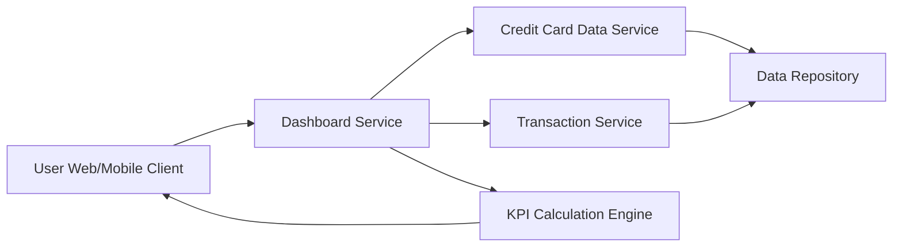

#### 1. High-Level Design

- **Summary**: This epic enables users to view a consolidated dashboard displaying key performance indicators (KPIs) for their credit card portfolio including monthly spend, total credit limit, available credit, and outstanding amounts. The dashboard provides an at-a-glance view of overall credit card financial health in a responsive interface.

- **Component Flow**:

- **Integration Points**: 
  - **Upstream**: Credit Card Data Service (retrieves card details and balances)
  - **Upstream**: Transaction Service (calculates monthly spend metrics)
  - **Internal**: KPI Calculation Engine (real-time calculation of available credit and outstanding amounts)

- **Key Assumptions**: 
  - Credit card and transaction data are refreshed periodically; "real-time" calculation assumes near real-time data availability within acceptable latency.
  - Monthly spend is calculated for the current calendar month; no historical trend data beyond current month is required.

- **NFR Highlights**: Dashboard must load within 2 seconds; responsive design across desktop, tablet, and mobile devices; real-time calculation of available credit and outstanding amounts.

- **Data Flow**: User accesses dashboard → Dashboard Service requests card details from Credit Card Data Service and monthly spend from Transaction Service → KPI Calculation Engine aggregates total credit limit, calculates available credit (limit minus outstanding), and computes outstanding amounts → Processed KPIs are rendered on responsive UI → User views consolidated financial health metrics.

#### 2. Validation Report

- **Requirements Coverage**: The design comprehensively covers all stated scope elements including monthly spend display, total credit limit aggregation, available credit calculation, outstanding amount tracking, responsive dashboard layout, and KPI visualization components. All NFRs (2-second load time, responsive design, real-time calculations) are addressed through optimized service architecture and calculation engine. Dependencies on credit card data service and transaction service are clearly mapped.