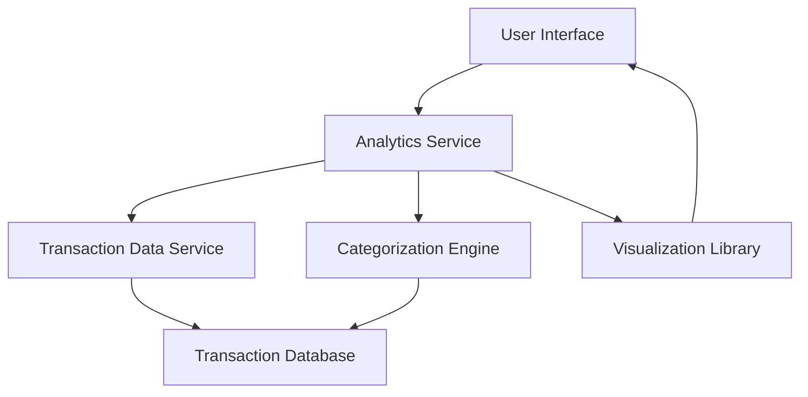

#### 1. High-Level Design

- **Summary**: This epic delivers comprehensive analytics and visualization capabilities enabling users to understand spending patterns through interactive charts and category-based analysis across nine predefined categories (Food & Dining, Fuel, Shopping, Travel, Entertainment, Utilities, Healthcare, Education, Miscellaneous). The system transforms raw transaction data into actionable insights for informed budgeting decisions.

- **Component Flow**:

- **Integration Points**: 
  - **Upstream**: Transaction Data Service (provides historical transaction records)
  - **Internal**: Categorization Engine (classifies transactions into 9 predefined categories)
  - **External**: Visualization Library (renders interactive charts and graphs)

- **Key Assumptions**: 
  - Transaction data is pre-stored and accessible via Transaction Data Service API with standard JSON format.
  - Categorization Engine uses rule-based or ML model with 95%+ accuracy; category assignment is deterministic per transaction.

- **NFR Highlights**: Analytics visualizations must render within 1.5 seconds; 95% or higher transaction categorization accuracy; interactive and responsive charts across all device types.

- **Data Flow**: User requests analytics view → Analytics Service fetches historical transactions from Transaction Data Service → Categorization Engine classifies transactions into 9 categories → Aggregated data is processed for monthly trends and category-wise spending → Visualization Library renders interactive charts → User views insights on UI with drill-down capabilities.

#### 2. Validation Report

- **Requirements Coverage**: The design fully covers the epic's stated scope including category-wise spending visualization, monthly spend trend analysis, interactive charts, nine spending categories support, transaction data aggregation, spending pattern identification, and visual analytics dashboard. All NFRs (1.5s render time, 95% categorization accuracy, responsive charts) are addressed through appropriate service layers and visualization components.