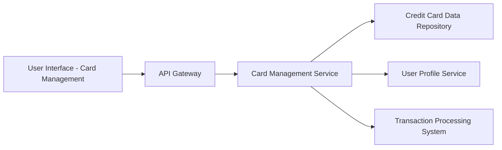

### 1. High-Level Design

**Summary:**  
This epic enables users to view and manage multiple credit cards within a unified interface. Users can see all registered credit cards with individual card details, perform card-wise spend analysis, track monthly spend trends for each card, and compare performance across their credit card portfolio.

**Component Flow:**

**Integration Points:**
- **Upstream:** Credit card data repository (stores and retrieves individual card details and metadata)
- **Upstream:** User profile service (links credit cards to user accounts and manages card registration)
- **Upstream:** Transaction processing system (provides transaction data for card-wise spend analysis and monthly trends)

**Key Assumptions:**
- Card registration process assumes cards are linked via user input or external integration, with validation handled by the Card Management Service.
- Monthly spend trends are calculated based on transaction data aggregated by card and month, with at least 12 months of historical data available.

**NFR Highlights:**  
System must support at least 10 credit cards per user; card data retrieval must complete within 1 second; interface must maintain performance with multiple cards displayed simultaneously.

### 2. Validation Report

**Requirements Coverage:**  
The design addresses all scope elements: multiple credit card display interface, card-wise spend analysis visualization, monthly spend trends tracking, individual card detail views, card comparison capabilities, and card registration/listing functionality. The architecture supports the NFRs through efficient data retrieval (1-second constraint) and scalable service design (10+ cards per user). Integration points align with specified dependencies (credit card data repository, user profile service, transaction processing system).