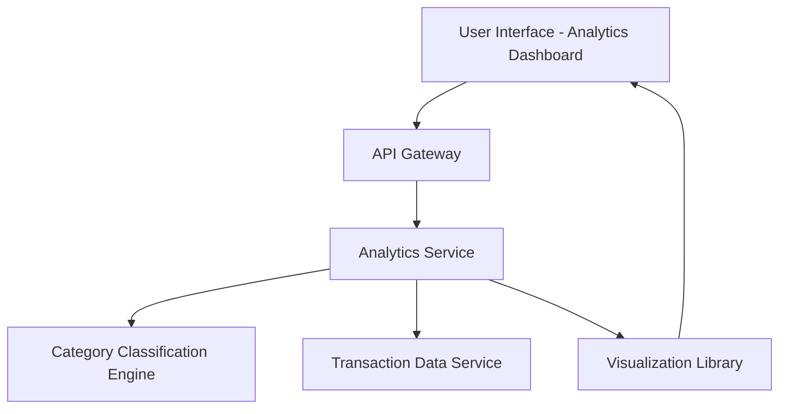

### 1. High-Level Design

**Summary:**  
This epic provides interactive analytics and visualization capabilities that enable users to understand spending patterns through category-wise analysis. Users can view transactions categorized into 9 predefined categories (Food & Dining, Fuel, Shopping, Travel, Entertainment, Utilities, Healthcare, Education, Miscellaneous) with visual representations of spending distribution, supporting data-driven financial decisions.

**Component Flow:**

**Integration Points:**
- **Upstream:** Transaction data service (provides raw transaction data for analysis)
- **Internal:** Category classification engine (categorizes transactions into 9 predefined categories)
- **Internal:** Analytics visualization library (renders interactive charts and graphs)
- **Internal:** Data aggregation service (aggregates transaction data for pattern analysis)

**Key Assumptions:**
- Transactions are automatically categorized by the Category Classification Engine using predefined rules or machine learning models; manual categorization is out of scope.
- Analytics cover at least 12 months of transaction history, with data stored and indexed for efficient retrieval and filtering.

**NFR Highlights:**  
Analytics visualizations must render within 3 seconds; system must handle transaction history of at least 12 months; interactive charts must support smooth user interactions with sub-second response times.

### 2. Validation Report

**Requirements Coverage:**  
The design covers all scope elements: category-wise spending visualization, interactive charts and graphs, transaction categorization across 9 predefined categories, spending pattern analysis, transaction history view, and filtering/drill-down capabilities. The architecture supports the NFRs through optimized rendering (3-second visualization load), efficient data handling (12-month history), and responsive interactions (sub-second response). Integration points align with specified dependencies (transaction data service, category classification engine, analytics visualization library, data aggregation service).