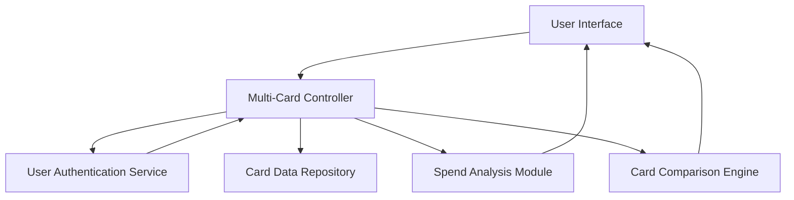

#### 1. High-Level Design

- **Summary:** This epic enables users to manage and monitor multiple credit cards within a single interface, allowing them to view all cards, access card-specific details, and perform card-wise spend analysis. The feature provides a comprehensive view of each card's individual performance, credit limits, and spending patterns, enabling users to compare and manage their credit card portfolio effectively for users maintaining multiple cards for different purposes.

- **Component Flow:**

- **Integration Points:**
  - **Upstream:** Card Data Repository (for storing and retrieving multiple card records)
  - **Upstream:** User Authentication Service (to ensure secure access to card information)
  - **Internal:** Spend Analysis Module (for card-wise spending calculations)
  - **Internal:** Card Comparison Engine (for comparing cards)

- **Key Assumptions:**
  - Sensitive card information (full card numbers) is masked in the UI; only last 4 digits are displayed with appropriate masking (e.g., **** **** **** 1234).
  - Near real-time data refresh is achieved through periodic polling or event-driven updates; exact refresh interval is configurable based on system requirements.

- **NFR Highlights:** System must handle display and processing of multiple cards simultaneously without performance degradation; data refresh for card information must be near real-time; secure handling of sensitive card information with appropriate masking.

- **Data Flow:** User logs in → User Authentication Service validates credentials and authorizes access → Multi-Card Controller retrieves all user's cards from Card Data Repository → Card information (with masked sensitive data) displayed on User Interface → User selects card for detailed analysis → Spend Analysis Module calculates card-specific spending → Card Comparison Engine enables side-by-side comparison of multiple cards → Results displayed with near real-time data refresh and no performance degradation.

#### 2. Validation Report

- **Requirements Coverage:** The design comprehensively covers all scope elements including multiple credit card display and listing, card-wise spend analysis functionality, individual card detail views, card-specific credit limit and balance tracking, and card comparison capabilities. The architecture addresses NFRs through efficient Multi-Card Controller for handling multiple cards simultaneously, near real-time refresh mechanisms, and secure data handling with masking in the UI layer. Dependencies on Card Data Repository and User Authentication Service are properly integrated. The design maintains clear boundaries for out-of-scope items (no real bank integration, card payments, fund transfers, loans, payment gateway integration).