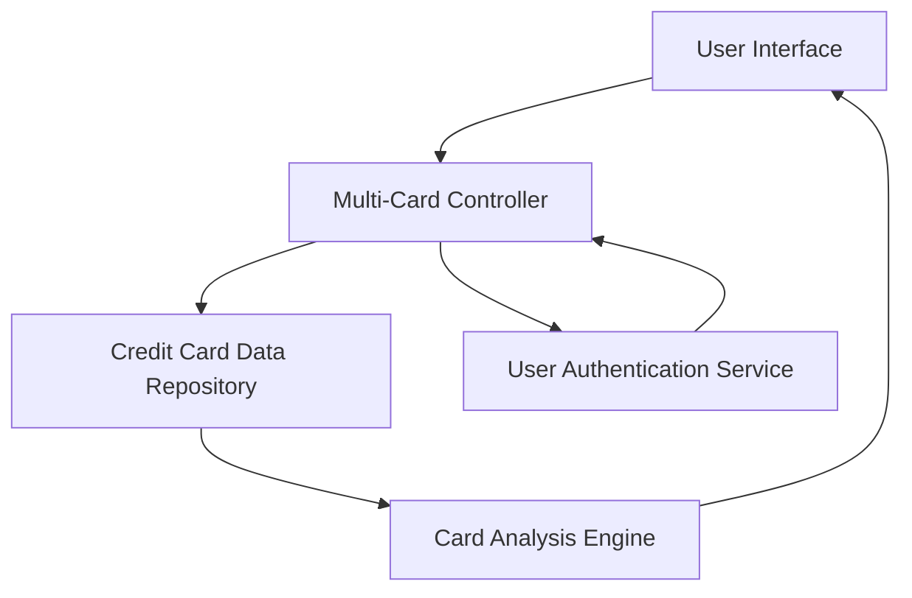

#### 1. High-Level Design

- **Summary:** This epic enables users to manage and monitor multiple credit cards within a single interface, providing card-specific details, card-wise spend analysis, individual card performance views, and card comparison capabilities with near-real-time data refresh and secure handling of sensitive card information with appropriate masking.

- **Component Flow:**

- **Integration Points:**
  - **Upstream:** Credit Card Data Repository (stores and retrieves multiple card records)
  - **Upstream:** User Authentication Service (ensures secure access to card information)
  - Card Analysis Engine for card-wise spend analysis and comparison

- **Key Assumptions:**
  - Sensitive card information (e.g., full card numbers) is masked in the UI, displaying only the last 4 digits.
  - Near-real-time data refresh is achieved through periodic polling or event-driven updates from the Credit Card Data Repository.

- **NFR Highlights:** System must handle display and processing of multiple cards simultaneously without performance degradation; data refresh for card information must be near real-time; secure handling of sensitive card information with appropriate masking.

- **Data Flow:** User logs in and accesses multi-card view → User Authentication Service validates user identity → Multi-Card Controller retrieves card records from Credit Card Data Repository → Card Analysis Engine processes card-specific spending and utilization data → Results are displayed in User Interface with sensitive information masked, allowing users to view individual card details, compare cards, and analyze card-wise spending patterns.

#### 2. Validation Report

- **Requirements Coverage:** The design comprehensively addresses the epic's scope including multiple credit card display and listing, card-wise spend analysis functionality, individual card detail views, card-specific credit limit and balance tracking, and card comparison capabilities. The architecture ensures all NFRs are met through efficient multi-card processing, near-real-time data refresh mechanisms, and secure handling with masking implemented in the Multi-Card Controller and User Interface layers.