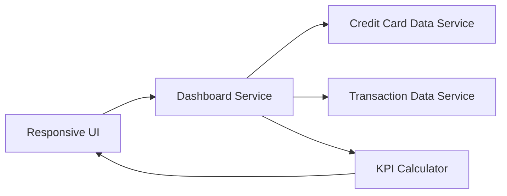

#### 1. High-Level Design

- **Summary:** This epic provides a modern, responsive dashboard offering a consolidated view of all credit cards with key performance indicators (monthly spend, total credit limit, available credit, outstanding amount). The dashboard serves as the central interface for monitoring financial health across multiple credit cards, providing immediate visibility into credit utilization and spending patterns, accessible across devices for on-the-go monitoring.

- **Component Flow:**

- **Integration Points:**
  - **Upstream:** Credit Card Data Service (for retrieving card details and balances)
  - **Upstream:** Transaction Data Service (for calculating monthly spend and outstanding amounts)
  - **Internal:** KPI Calculator (for computing consolidated metrics)

- **Key Assumptions:**
  - Responsive design is implemented using mobile-first approach with breakpoints for tablet and desktop; specific breakpoint values are determined during UI implementation.
  - Web accessibility standards compliance follows WCAG 2.1 Level AA guidelines (assumed standard; not explicitly specified in epic).

- **NFR Highlights:** System must support responsive design across desktop, tablet, and mobile devices; dashboard load time must be optimized for quick access to financial data; UI must be accessible and comply with web accessibility standards.

- **Data Flow:** User accesses dashboard from any device → Responsive UI adapts layout based on device type → Dashboard Service fetches card details from Credit Card Data Service and transaction data from Transaction Data Service → KPI Calculator computes monthly spend, total credit limit, available credit, and outstanding amount across all cards → Consolidated KPIs rendered on Responsive UI with optimized load time → Multi-card view displayed with accessibility features enabled.

#### 2. Validation Report

- **Requirements Coverage:** The design fully addresses the epic's scope including dashboard interface design and development, monthly spend KPI display, total credit limit calculation and display, available credit calculation and display, outstanding amount tracking, responsive layout implementation, and multi-card consolidated view. The architecture supports NFRs through responsive design patterns, optimized Dashboard Service for quick load times, and accessibility compliance in the UI layer. Integration requirements with Credit Card Data Service and Transaction Data Service are properly met. Out-of-scope boundaries (no real bank integration, payments, fund transfers, loans) are maintained.