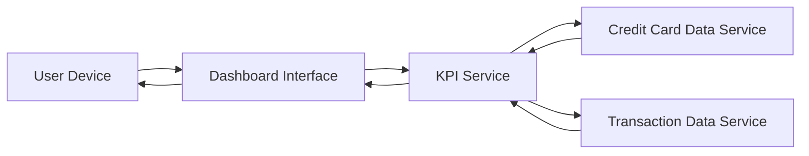

#### 1. High-Level Design

- **Summary:** This epic enables users to access a modern, responsive dashboard providing a consolidated view of all credit cards with KPIs (monthly spend, total credit limit, available credit, outstanding amount), designed to be accessible across desktop, tablet, and mobile devices with optimized load times and web accessibility compliance.

- **Component Flow:**

- **Integration Points:**
  - **Upstream:** Credit Card Data Service (retrieves card details and balances)
  - **Upstream:** Transaction Data Service (calculates monthly spend and outstanding amounts)
  - KPI Service for aggregating and computing financial metrics

- **Key Assumptions:**
  - Dashboard uses responsive web design principles to adapt to different screen sizes (desktop, tablet, mobile).
  - Web accessibility standards (WCAG 2.1 AA or similar) are implemented in the Dashboard Interface layer.

- **NFR Highlights:** System must support responsive design across desktop, tablet, and mobile devices; dashboard load time must be optimized for quick access to financial data; UI must be accessible and comply with web accessibility standards.

- **Data Flow:** User accesses dashboard from any device → Dashboard Interface requests KPIs from KPI Service → KPI Service retrieves card details from Credit Card Data Service and transaction data from Transaction Data Service → KPIs are calculated and aggregated → Responsive dashboard renders consolidated multi-card view with all KPIs on User Device, ensuring accessibility compliance.

#### 2. Validation Report

- **Requirements Coverage:** The design fully covers the epic's scope including dashboard interface design and development, monthly spend KPI display, total credit limit calculation and display, available credit calculation and display, outstanding amount tracking, responsive layout implementation, and multi-card consolidated view. The architecture addresses all NFRs through responsive design implementation, optimized data retrieval for quick load times, and accessibility compliance in the Dashboard Interface layer.