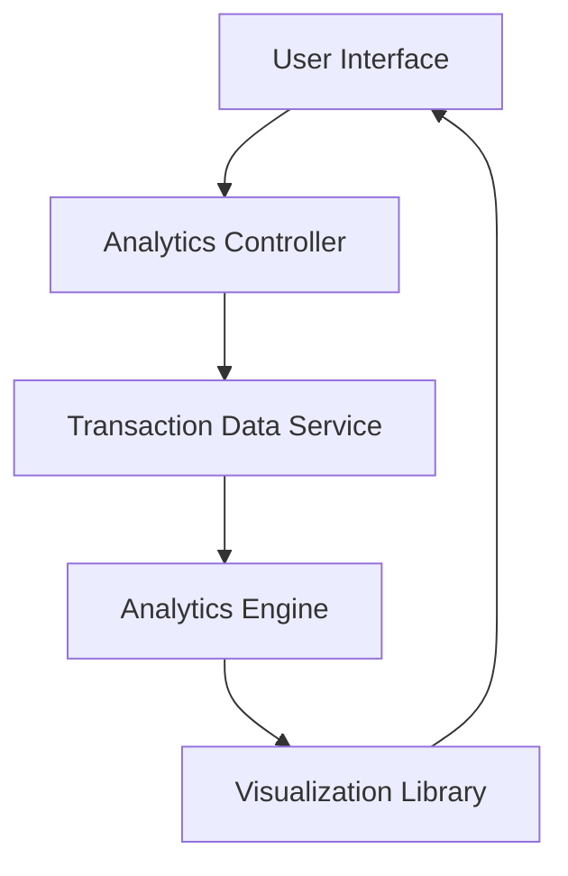

#### 1. High-Level Design

- **Summary:** This epic provides interactive analytics and visualization capabilities for understanding spending patterns through category-wise analysis across nine predefined categories (Food & Dining, Fuel, Shopping, Travel, Entertainment, Utilities, Healthcare, Education, Miscellaneous) and monthly spend trends with near-instant insights and smooth rendering of large transaction datasets.

- **Component Flow:**

- **Integration Points:**
  - **Upstream:** Transaction Data Service (retrieves and categorizes transaction records)
  - **Downstream:** Analytics Engine (processes and aggregates spending data)
  - **Downstream:** Visualization Library (renders interactive charts)

- **Key Assumptions:**
  - Transactions are pre-categorized into one of the nine categories by the Transaction Data Service.
  - Historical transaction data is optimized for efficient querying to enable near-instant analytics processing.

- **NFR Highlights:** Analytics calculations must process transaction data efficiently to provide near-instant insights; visualizations must render smoothly with large transaction datasets; system must support historical data analysis for trend identification.

- **Data Flow:** User requests spending analytics → Analytics Controller fetches transaction records from Transaction Data Service → Analytics Engine aggregates data by category and time period, calculating trends and patterns → Processed data is passed to Visualization Library → Interactive charts and graphs are rendered in User Interface, allowing users to explore category-wise spending and monthly trends.

#### 2. Validation Report

- **Requirements Coverage:** The design comprehensively covers the epic's scope including category-wise spending visualization, monthly spend trend analysis, interactive charts and graphs, transaction data aggregation by category, spending pattern identification across nine categories, and time-based spending analysis. The architecture supports the NFRs through efficient data processing in the Analytics Engine and optimized rendering via the Visualization Library to handle large datasets smoothly.