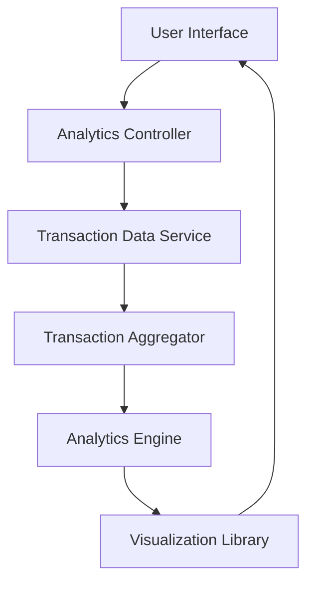

#### 1. High-Level Design

- **Summary:** This epic delivers interactive analytics and visualization capabilities for users to understand spending patterns through category-wise analysis and monthly spend trends. Users can view detailed expense breakdowns across nine predefined categories (Food & Dining, Fuel, Shopping, Travel, Entertainment, Utilities, Healthcare, Education, Miscellaneous) with monthly trend analysis to identify spending patterns over time and make informed financial decisions.

- **Component Flow:**

- **Integration Points:**
  - **Upstream:** Transaction Data Service (for retrieving and categorizing transaction records)
  - **Internal:** Analytics Engine (for processing and aggregating spending data)
  - **Internal:** Visualization Library (for rendering interactive charts)

- **Key Assumptions:**
  - Transaction categorization into the nine predefined categories is performed by the Transaction Data Service; categorization logic is rule-based or ML-driven (not specified).
  - Historical data retention period supports trend identification; minimum retention period aligns with business requirements (not explicitly specified in epic).

- **NFR Highlights:** Analytics calculations must process transaction data efficiently to provide near-instant insights; visualizations must render smoothly with large transaction datasets; system must support historical data analysis for trend identification.

- **Data Flow:** User requests spending analytics → Analytics Controller calls Transaction Data Service to retrieve transaction records → Transaction Aggregator groups transactions by category and time period → Analytics Engine processes aggregated data to calculate trends and patterns → Visualization Library renders interactive charts and graphs → Analytics displayed to User Interface with smooth rendering performance for large datasets.

#### 2. Validation Report

- **Requirements Coverage:** The design comprehensively covers all scope elements including category-wise spending visualization, monthly spend trend analysis, interactive charts and graphs, transaction data aggregation by category, spending pattern identification across nine categories, and time-based spending analysis. The architecture addresses NFRs through efficient processing (Transaction Aggregator, Analytics Engine) and smooth rendering (Visualization Library). Integration dependencies with Transaction Data Service, Analytics Engine, and Visualization Library are clearly defined. The design maintains boundaries for out-of-scope items (no real bank integration, payments, fund transfers, loans).