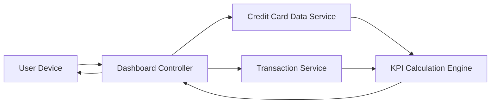

#### 1. High-Level Design

- **Summary:** This epic delivers a centralized, responsive dashboard displaying critical financial KPIs (monthly spend, total credit limit, available credit, outstanding amount) across all credit cards with a 2-second load time, supporting desktop and mobile devices with real-time data refresh capabilities.

- **Component Flow:**

- **Integration Points:**
  - **Upstream:** Credit Card Data Service (retrieves card balances and limits)
  - **Upstream:** Transaction Service (calculates monthly spend and outstanding amounts)
  - KPI Calculation Engine for real-time aggregation

- **Key Assumptions:**
  - KPIs are calculated in real-time or near-real-time using cached aggregates to meet the 2-second load time requirement.
  - Responsive design framework is used to ensure consistent experience across desktop, tablet, and mobile devices.

- **NFR Highlights:** Dashboard must load within 2 seconds; support responsive design across desktop and mobile devices; handle real-time data refresh for KPI updates.

- **Data Flow:** User accesses dashboard → Dashboard Controller requests card data from Credit Card Data Service and transaction data from Transaction Service → KPI Calculation Engine aggregates data to compute monthly spend, total credit limit, available credit, and outstanding amount → Consolidated KPIs are returned to Dashboard Controller → Responsive dashboard renders on User Device with real-time updates.

#### 2. Validation Report

- **Requirements Coverage:** The design fully addresses the epic's scope including monthly spend display, total credit limit calculation, available credit tracking, outstanding amount monitoring, responsive dashboard layout, and consolidated multi-card view. The architecture ensures the 2-second load time NFR through efficient data retrieval and KPI calculation, while responsive design support is built into the Dashboard Controller and User Interface layer.