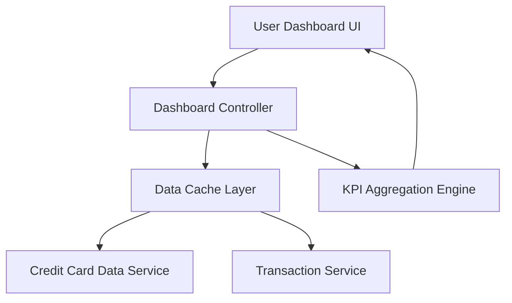

#### 1. High-Level Design

- **Summary:** This epic provides a centralized dashboard displaying critical financial metrics (monthly spend, total credit limit, available credit, outstanding amount) across all credit cards. The dashboard offers a consolidated, real-time view of the user's credit card portfolio for monitoring financial health through KPIs, with a modern, responsive interface optimized for quick decision-making.

- **Component Flow:**

- **Integration Points:**
  - **Upstream:** Credit Card Data Service (for retrieving card balances and limits)
  - **Upstream:** Transaction Service (for calculating monthly spend and outstanding amounts)
  - **Internal:** KPI Aggregation Engine (for consolidating multi-card metrics)

- **Key Assumptions:**
  - Real-time data refresh is achieved through periodic polling or event-driven updates from upstream services; exact refresh mechanism is implementation-dependent.
  - Monthly spend is calculated based on the current calendar month; timezone considerations are handled by the Transaction Service.

- **NFR Highlights:** Dashboard must load within 2 seconds; support responsive design across desktop and mobile devices; handle real-time data refresh for KPI updates.

- **Data Flow:** User accesses dashboard → Dashboard Controller checks Data Cache Layer for recent data → If cache miss, controller fetches card data from Credit Card Data Service and transaction data from Transaction Service → KPI Aggregation Engine consolidates metrics (monthly spend, total credit limit, available credit, outstanding amount) across all cards → Aggregated KPIs displayed on User Dashboard UI → Cache updated for subsequent requests to meet 2-second load time requirement.

#### 2. Validation Report

- **Requirements Coverage:** The design fully addresses the epic's scope including monthly spend display, total credit limit calculation, available credit tracking, outstanding amount monitoring, responsive dashboard layout, and consolidated multi-card view. The architecture incorporates a Data Cache Layer to meet the 2-second load time NFR and supports responsive design across devices. Real-time data refresh is enabled through the cache invalidation strategy and KPI Aggregation Engine. Dependencies on Credit Card Data Service and Transaction Service are properly integrated. Out-of-scope items (real bank integration, payments, fund transfers) are appropriately excluded.