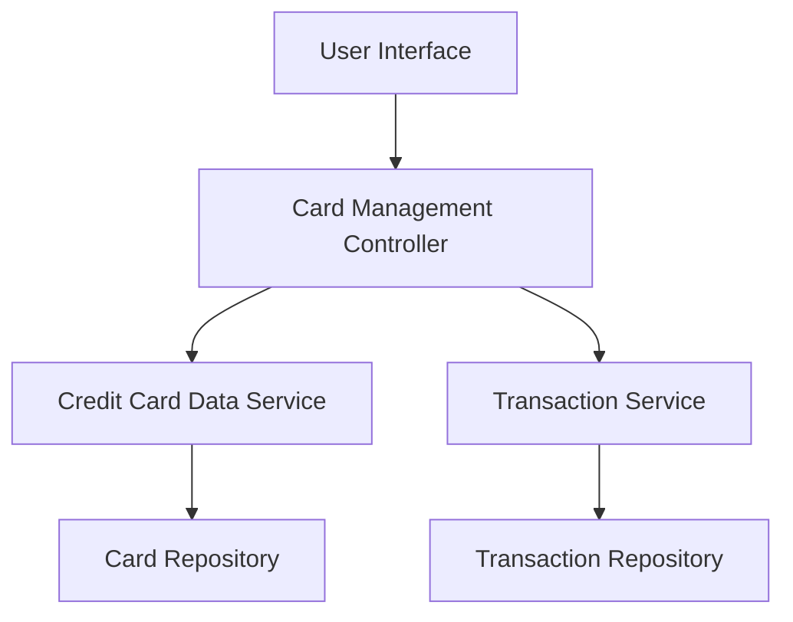

#### 1. High-Level Design

- **Summary:** This epic enables users to view and manage multiple credit cards within a single interface, providing card-wise spend analysis and detailed information for each card. Users can track individual card performance, compare spending across different cards, and understand each card's contribution to their overall financial picture with card-specific insights including balances, limits, and utilization rates.

- **Component Flow:**

- **Integration Points:**
  - **Upstream:** Credit Card Data Service (for card details and balances)
  - **Upstream:** Transaction Service (for card-specific spending data)
  - **Data Sources:** Card Repository, Transaction Repository

- **Key Assumptions:**
  - Each credit card has a unique identifier that links transactions to specific cards in the transaction repository.
  - Card data (balances, limits) is refreshed periodically by the Credit Card Data Service; refresh frequency is determined by system configuration.

- **NFR Highlights:** System must support management of at least 10 credit cards per user; card switching and filtering operations must complete within 500ms.

- **Data Flow:** User selects card view → Card Management Controller requests card list from Credit Card Data Service → Card details retrieved from Card Repository → Controller requests card-specific spending from Transaction Service → Transaction data retrieved from Transaction Repository → Aggregated card information with spending analysis displayed to User Interface → User can switch/filter cards with sub-500ms response time.

#### 2. Validation Report

- **Requirements Coverage:** The design comprehensively covers all stated requirements including multiple credit card display, card-wise spend analysis, individual card details view, card comparison capabilities, and card-specific balance and limit tracking. The architecture supports the NFR of managing at least 10 cards per user and ensures card switching/filtering operations complete within 500ms through optimized controller logic. Integration dependencies with Credit Card Data Service and Transaction Service are properly addressed. The design maintains clear boundaries for out-of-scope items (no real bank integration, payments, card application/closure).