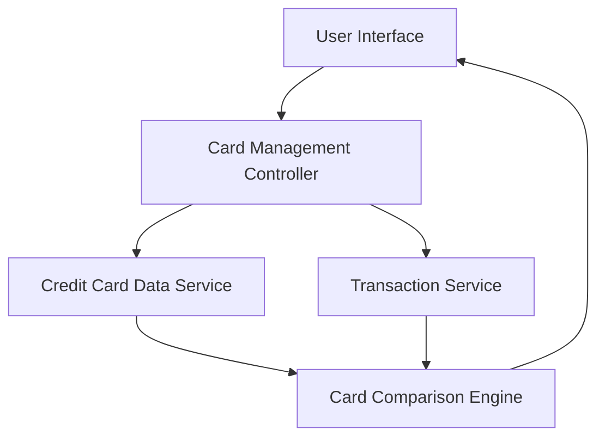

#### 1. High-Level Design

- **Summary:** This epic enables users to view and manage multiple credit cards (up to 10 per user) within a single interface, providing card-wise spend analysis, individual card details, comparison capabilities, and card-specific balance and limit tracking with card switching operations completing within 500ms.

- **Component Flow:**

- **Integration Points:**
  - **Upstream:** Credit Card Data Service (provides card details, balances, and limits)
  - **Upstream:** Transaction Service (provides card-specific spending data)
  - Card Comparison Engine for multi-card analytics

- **Key Assumptions:**
  - Each user can have a maximum of 10 credit cards linked to their account.
  - Card data is cached or indexed to ensure card switching operations complete within 500ms.

- **NFR Highlights:** System must support management of at least 10 credit cards per user; card switching and filtering operations must complete within 500ms.

- **Data Flow:** User selects a card or requests multi-card view → Card Management Controller retrieves card details from Credit Card Data Service and spending data from Transaction Service → Data is aggregated by Card Comparison Engine for comparison views → Results are displayed in User Interface with options to switch between cards, view individual details, and compare performance metrics.

#### 2. Validation Report

- **Requirements Coverage:** The design comprehensively covers the epic's scope including multiple credit card display, card-wise spend analysis, individual card details view, card comparison capabilities, and card-specific balance/limit tracking. The architecture supports the NFR of managing at least 10 cards per user and ensures 500ms card switching through efficient data retrieval and caching strategies in the Card Management Controller.