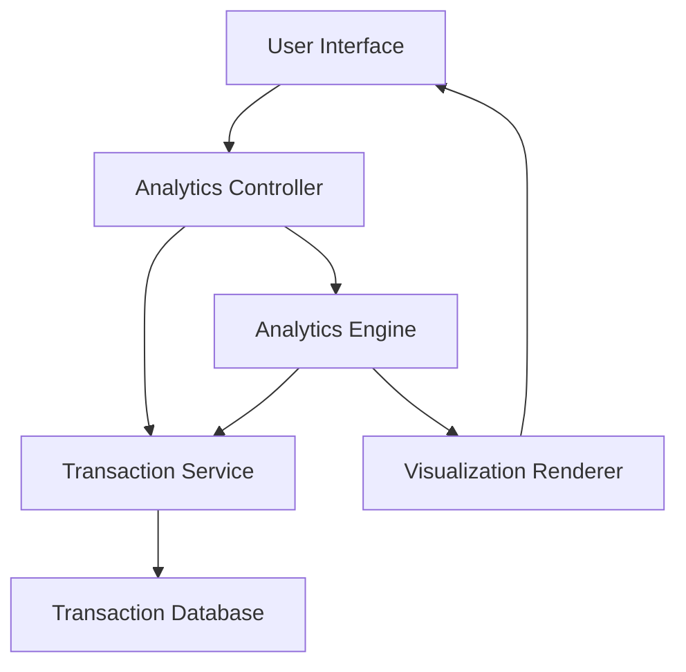

#### 1. High-Level Design

- **Summary:** This epic delivers interactive visualizations and analytics for users to understand spending patterns through category-wise analysis and monthly spend trends across nine predefined categories (Food & Dining, Fuel, Shopping, Travel, Entertainment, Utilities, Healthcare, Education, Miscellaneous). It provides visual representations, trend analysis, and actionable insights for financial optimization.

- **Component Flow:**

- **Integration Points:** 
  - **Upstream:** Transaction Service (for categorized transaction data)
  - **Downstream:** Analytics Engine (for trend calculations and pattern recognition)
  - **Data Source:** Transaction Database

- **Key Assumptions:** 
  - Transactions are pre-categorized by the transaction service into one of the nine categories; no manual categorization by users is required.
  - Historical transaction data is retained for at least 12 months in the transaction database for trend analysis.

- **NFR Highlights:** Analytics visualizations must render within 3 seconds; filtering and drill-down operations must complete in sub-second response time; system must handle minimum 12 months of historical transaction data.

- **Data Flow:** User requests analytics view → Analytics Controller fetches categorized transaction data from Transaction Service → Transaction Service retrieves data from Transaction Database → Analytics Engine processes data for trend calculations and pattern recognition → Visualization Renderer generates interactive charts and graphs → Rendered visualizations displayed to User Interface.

#### 2. Validation Report

- **Requirements Coverage:** The design fully covers the epic's stated scope including category-wise spending visualization, monthly spend trend analysis, interactive charts, transaction categorization across nine categories, spending pattern identification, and historical trend tracking. All NFRs (3-second render time, sub-second filtering, 12-month historical data) are addressed through the architecture with dedicated Analytics Engine and optimized data retrieval. Integration points with Transaction Service and Analytics Engine are clearly defined. The design supports all in-scope features while respecting the out-of-scope boundaries (no real bank integration, custom categories, or budget setting).