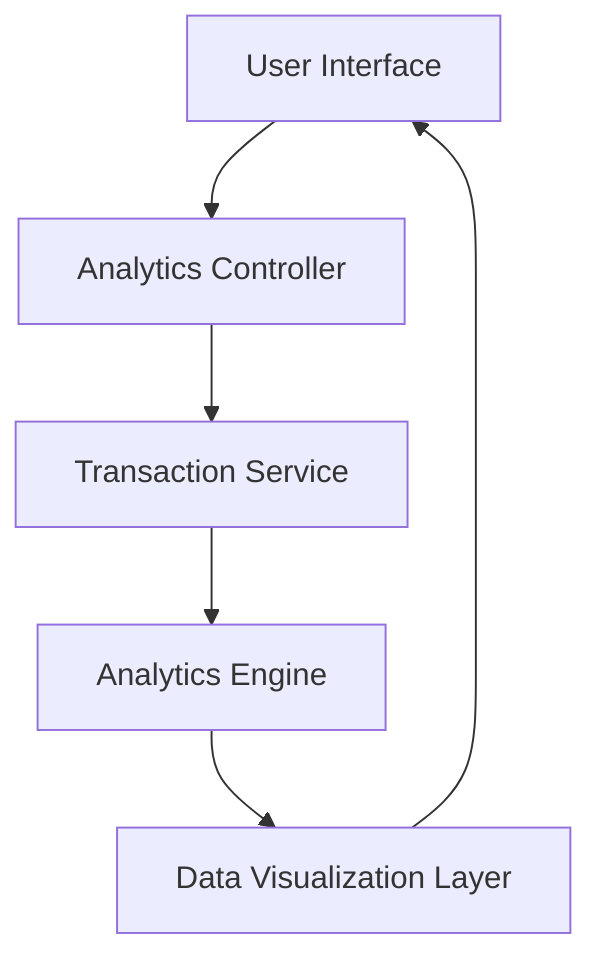

#### 1. High-Level Design

- **Summary:** This epic provides users with interactive visualizations and analytics to understand spending patterns through category-wise analysis across nine predefined categories (Food & Dining, Fuel, Shopping, Travel, Entertainment, Utilities, Healthcare, Education, Miscellaneous) and monthly spend trends over a minimum of 12 months of historical data.

- **Component Flow:**

- **Integration Points:**
  - **Upstream:** Transaction Service (provides categorized transaction data)
  - **Downstream:** Analytics Engine (performs trend calculations and pattern recognition)
  - Visualization Library for rendering interactive charts

- **Key Assumptions:**
  - Transaction data is pre-categorized by the Transaction Service into one of the nine predefined categories.
  - Historical data is retained for at least 12 months and is readily accessible for trend analysis.

- **NFR Highlights:** Analytics visualizations must render within 3 seconds; filtering and drill-down operations must respond in sub-second time; must handle minimum 12 months of historical transaction data.

- **Data Flow:** User requests analytics view → Analytics Controller fetches transaction data from Transaction Service → Data is processed by Analytics Engine to calculate trends and patterns → Results are formatted and sent to Data Visualization Layer → Interactive charts/graphs are rendered in the User Interface, allowing users to filter, drill down, and explore spending insights.

#### 2. Validation Report

- **Requirements Coverage:** The design fully covers the epic's stated scope including category-wise visualization, monthly trend analysis, interactive charts, transaction categorization across nine categories, and historical trend tracking. All NFRs regarding rendering performance (3 seconds), sub-second filtering, and 12-month data retention are addressed through the architecture's separation of concerns between data retrieval, analytics processing, and visualization rendering.