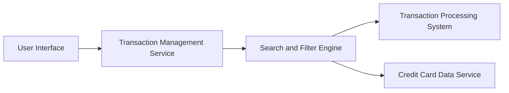

#### 1. High-Level Design

- **Summary:** This epic enables comprehensive transaction tracking and management across all user credit cards. Users can view complete transaction history, search and filter transactions by card, date range, and transaction type, and access detailed transaction information. The solution provides a centralized interface for monitoring all credit card spending activities with fast query performance.

- **Component Flow:**

- **Integration Points:**
  - **Upstream:** Transaction Processing System (retrieves transaction data with filtering and search capabilities)
  - **Upstream:** Credit Card Data Service (maps transactions to specific cards and provides card metadata)
  - **Downstream:** User Interface (displays transaction lists and details in responsive layout)

- **Key Assumptions:**
  - Transaction data includes searchable fields (merchant name, amount, category, date) indexed for sub-second query performance.
  - Pagination or lazy loading is implemented to handle large transaction volumes efficiently.

- **NFR Highlights:** System must handle large transaction volumes efficiently; transaction queries must return results within 1 second; data must be displayed in a responsive layout across all devices.

#### 2. Validation Report

- **Requirements Coverage:** The design comprehensively covers all scope items including transaction listing, transaction search and filtering, card-wise transaction view, transaction details display, and transaction history access. The architecture includes a dedicated Search and Filter Engine to meet the 1-second query performance requirement, and the component design supports efficient handling of large transaction volumes through appropriate indexing and query optimization. All NFRs (1-second query response, large volume handling, responsive layout) are addressed through the proposed architecture.