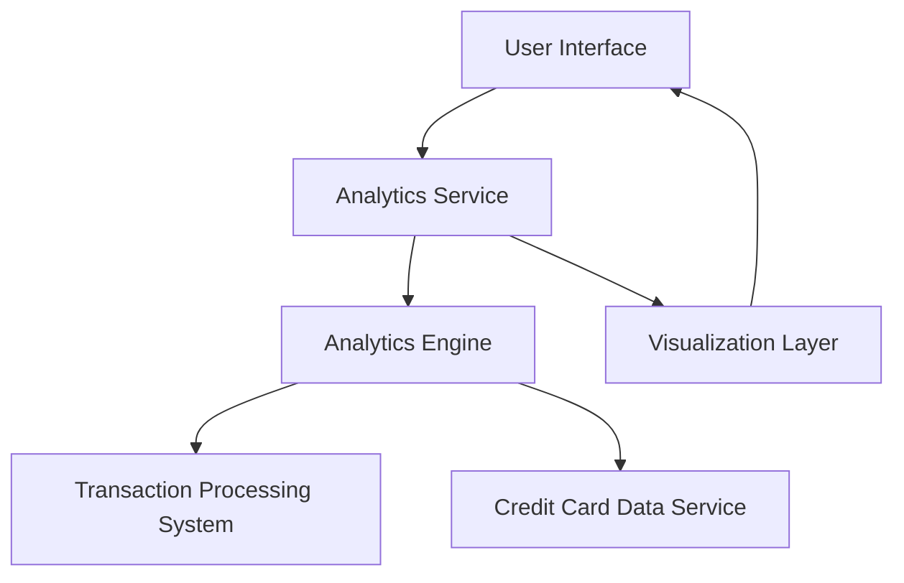

#### 1. High-Level Design

- **Summary:** This epic provides interactive visualizations and analytical capabilities to help users understand spending patterns across multiple dimensions. Users can analyze spending by category (Food & Dining, Fuel, Shopping, Travel, Entertainment, Utilities, Healthcare, Education, Miscellaneous), view monthly trends, and perform card-wise spend analysis. The solution enables data-driven insights into spending behavior through visual charts and graphs.

- **Component Flow:**

- **Integration Points:**
  - **Upstream:** Transaction Processing System (aggregates spending data by category, date, and card)
  - **Upstream:** Analytics Engine (calculates trends, patterns, and spending breakdowns)
  - **Upstream:** Credit Card Data Service (provides card-specific metadata for analysis)
  - **Downstream:** Visualization Layer (renders interactive charts and graphs)

- **Key Assumptions:**
  - Category classification is performed upstream in the Transaction Processing System or stored with transaction records.
  - Historical data is retained for at least 12 months to support meaningful trend analysis.

- **NFR Highlights:** Visualizations must render within 1.5 seconds; must support interactive filtering and drill-down capabilities; charts must be responsive and mobile-friendly.

#### 2. Validation Report

- **Requirements Coverage:** The design fully addresses all scope items including category-wise spending visualization, monthly spend trends analysis, card-wise spend analysis, interactive charts and graphs, spending pattern identification, and multi-category spending breakdown. The architecture incorporates dedicated analytics and visualization layers to support the required interactive capabilities. All NFRs (1.5-second render time, interactive filtering, responsive design) are supported through appropriate component separation and caching strategies.