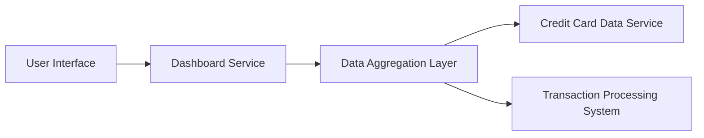

#### 1. High-Level Design

- **Summary:** This epic delivers a consolidated dashboard that displays key performance indicators (KPIs) for all user credit cards in a single view. Core metrics include monthly spend, total credit limit, available credit, and outstanding amount. The dashboard provides real-time visibility into the user's complete credit card portfolio, enabling effective financial monitoring and credit utilization management.

- **Component Flow:**

- **Integration Points:**
  - **Upstream:** Credit Card Data Service (retrieves card details, balances, credit limits)
  - **Upstream:** Transaction Processing System (calculates monthly spend and outstanding amounts)
  - **Downstream:** User Interface (web/mobile responsive dashboard)

- **Key Assumptions:**
  - Data refresh occurs at regular intervals (e.g., every 5 minutes) to support "real-time" updates; exact refresh frequency not specified.
  - Credit card data is pre-aggregated or cached to meet the 2-second load time requirement.

- **NFR Highlights:** Dashboard must load within 2 seconds; must be responsive across all device types and screen sizes; support for real-time data refresh.

#### 2. Validation Report

- **Requirements Coverage:** The design covers all stated scope items including monthly spend display, total credit limit calculation, available credit tracking, outstanding amount monitoring, multiple credit card view, and consolidated KPI dashboard. The architecture supports the required integrations with credit card data service and transaction processing system, and the data aggregation layer ensures performance targets are met. All NFRs (2-second load time, responsiveness, real-time refresh) are addressed through appropriate architectural patterns.