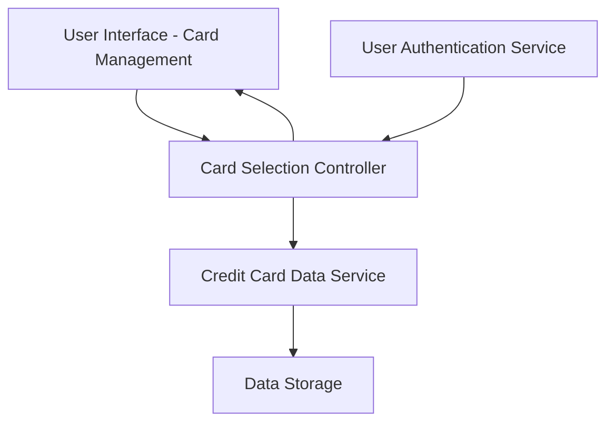

#### 1. High-Level Design

- **Summary:** This epic enables users to view and manage multiple credit cards within a single interface, supporting card display, selection, switching, comparison, and access to card-specific details. The interface is designed to be intuitive and responsive across all devices.

- **Component Flow:**

- **Integration Points:**
  - **Upstream:** Credit Card Data Service (retrieves card information for display)
  - **Upstream:** User Authentication Service (associates cards with specific users)
  - **Downstream:** User Interface (displays multiple cards and enables switching/comparison)

- **Key Assumptions:** 
  - Card data is pre-loaded or cached for fast switching (under 300ms latency requirement).
  - User authentication is handled by a separate service that provides user identity and card associations.

- **NFR Highlights:** System must support display of at least 10 credit cards per user without performance issues; Card switching must occur with latency under 300ms; Interface must be fully responsive on all device sizes.

#### 2. Validation Report

- **Requirements Coverage:** The design addresses all scope elements including multiple credit card display, card selection and switching, card-specific details view, card comparison capability, responsive card layout, and card listing interface. The architecture incorporates both required dependencies (credit card data service and user authentication service) and supports the NFR requirements for performance (10+ cards, <300ms switching) and responsiveness across devices.