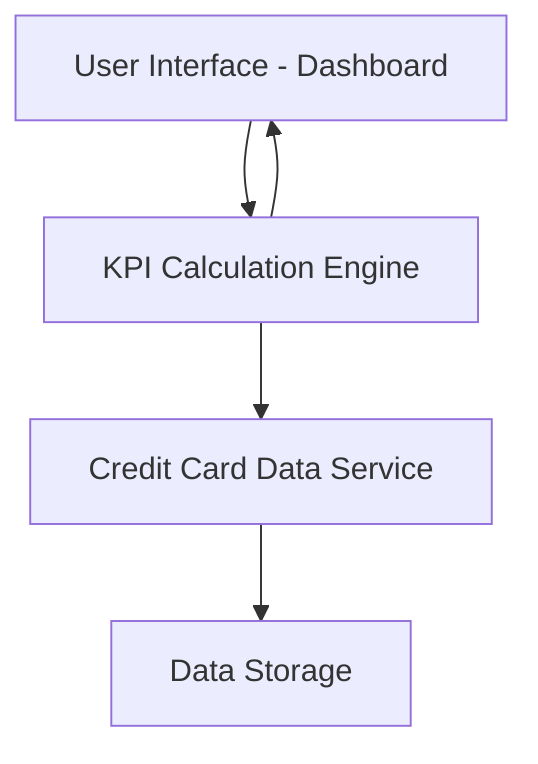

#### 1. High-Level Design

- **Summary:** This epic delivers a consolidated dashboard that displays key performance indicators (KPIs) for a user's credit card portfolio, including monthly spend, total credit limit, available credit, and outstanding amounts. The dashboard provides real-time visibility into financial health across all cards in a responsive interface.

- **Component Flow:**

- **Integration Points:**
  - **Upstream:** Credit Card Data Service (retrieves card details and transaction data)
  - **Upstream:** Calculation Engine (aggregates KPIs across multiple cards)
  - **Downstream:** User Interface (displays consolidated KPIs)

- **Key Assumptions:** 
  - KPI data is refreshed at regular intervals (assumed real-time polling or event-driven updates).
  - Credit card data service provides standardized API responses with consistent data formats for all card types.

- **NFR Highlights:** Dashboard must be responsive across desktop, tablet, and mobile devices; KPI calculations must update in real-time; UI must support concurrent viewing of multiple credit cards without performance degradation.

#### 2. Validation Report

- **Requirements Coverage:** The design covers all stated scope elements including monthly spend display, total credit limit aggregation, available credit calculation, outstanding amount tracking, responsive dashboard layout, and multi-card KPI consolidation. The architecture supports real-time KPI updates and responsive design requirements. All specified dependencies (credit card data service and calculation engine) are integrated into the component flow.