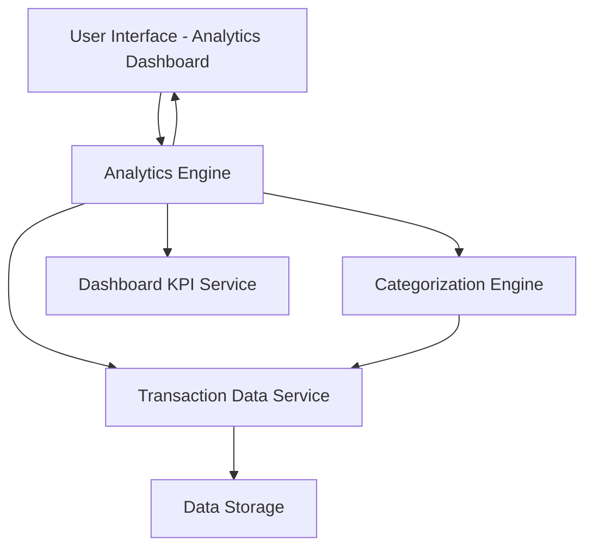

#### 1. High-Level Design

- **Summary:** This epic provides comprehensive analytics and visualization capabilities that enable users to understand spending patterns through interactive charts. Users can analyze spending by category (Food & Dining, Fuel, Shopping, Travel, Entertainment, Utilities, Healthcare, Education, Miscellaneous), view monthly trends, and see card-wise spend breakdowns.

- **Component Flow:**

- **Integration Points:**
  - **Upstream:** Transaction Data Service (retrieves spending records)
  - **Upstream:** Categorization Engine (classifies transactions into spending categories)
  - **Upstream:** Dashboard KPI Service (ensures consistent data presentation)
  - **Downstream:** User Interface (displays interactive charts and visualizations)

- **Key Assumptions:** 
  - Transaction categorization is automated using predefined rules or ML models; manual recategorization is out of scope.
  - Historical data for 12 months is readily available and indexed for fast query performance.

- **NFR Highlights:** Analytics visualizations must load within 2 seconds; System must support analysis of at least 12 months of historical transaction data; Charts must be interactive and responsive across all devices.

#### 2. Validation Report

- **Requirements Coverage:** The design comprehensively covers all scope elements including category-wise spending visualization, monthly spend trends, card-wise spend analysis, interactive charts and graphs, spending pattern identification, multi-category breakdown, and transaction categorization. All three dependencies (transaction data service, categorization engine, and dashboard KPI service) are integrated into the architecture. The design supports the NFR requirements for performance (2-second load time), data retention (12 months), and responsive interactive visualizations.