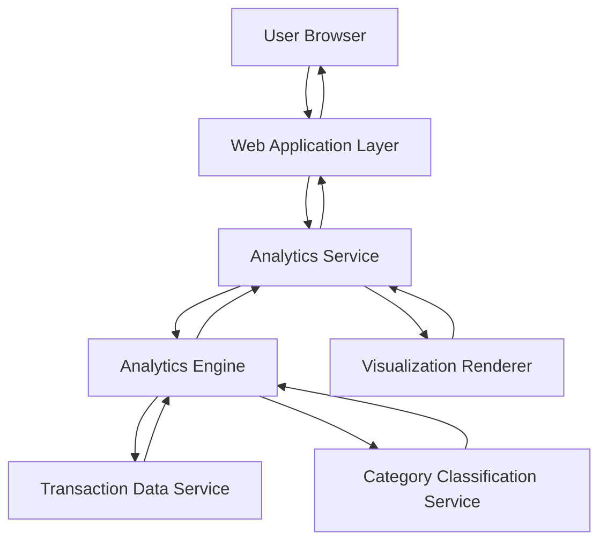

#### 1. High-Level Design

- **Summary:** This epic provides interactive visualizations and analytics for deep spending pattern insights across 9 predefined categories (Food & Dining, Fuel, Shopping, Travel, Entertainment, Utilities, Healthcare, Education, Miscellaneous). It includes monthly spend trend analysis and category-wise breakdowns through interactive charts and graphs, enabling data-driven financial decisions.

- **Component Flow:**

- **Integration Points:**
  - **Upstream:** None explicitly mentioned (assumes user context passed from authentication layer)
  - **Downstream:** Transaction Data Service (for categorized transaction information), Category Classification Service (for transaction categorization logic), Analytics Engine (for data aggregation and trend calculation)

- **Key Assumptions:**
  - Transactions are pre-categorized by Category Classification Service for real-time analytics performance.
  - Analytics Engine maintains monthly aggregated data for trend analysis efficiency.

- **NFR Highlights:** Analytics visualizations must render within 3 seconds; support filtering and drill-down; interactive and responsive charts across all devices; accurate and real-time category calculations.

- **Data Flow:** User accesses analytics interface → Analytics Service requests data from Analytics Engine → Engine retrieves categorized transactions from Transaction Data Service → Category Classification Service ensures proper categorization across 9 categories → Engine aggregates data by category and time period, calculates monthly trends → Aggregated analytics data passed to Visualization Renderer → Renderer generates interactive charts (category breakdowns, trend graphs) → Analytics Service delivers visualizations to Web Application Layer → User interacts with responsive, drill-down capable analytics interface.

#### 2. Validation Report

- **Requirements Coverage:** The design fully addresses all scope requirements including category-wise visualization for all 9 specified categories, monthly trend analysis, interactive charts, and responsive analytics interface. The architecture supports the 3-second rendering NFR through pre-categorized data and efficient aggregation in the Analytics Engine. Filtering and drill-down capabilities are enabled through the Visualization Renderer component. Real-time accuracy is maintained through direct integration with Transaction Data Service and Category Classification Service. All stated NFRs (performance, interactivity, responsiveness, accuracy) are architecturally supported.