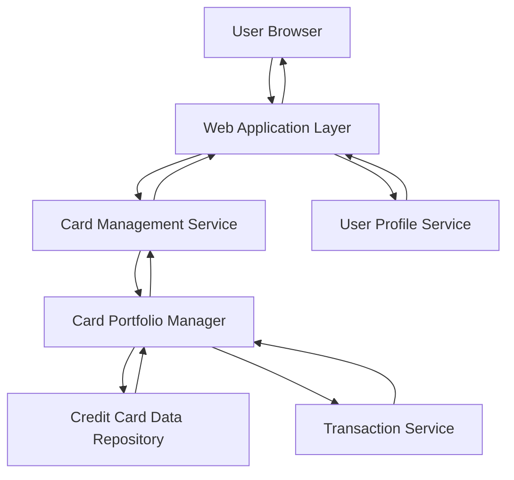

#### 1. High-Level Design

- **Summary:** This epic enables users to manage and monitor multiple credit cards (minimum 10 per user) from a unified interface. Users can view all cards with individual details, perform card-wise spend analysis, track card-specific metrics (limits, outstanding balances), and compare cards within their portfolio with clear visual differentiation.

- **Component Flow:**

- **Integration Points:**
  - **Upstream:** User Profile Service (for card ownership validation and user context)
  - **Downstream:** Credit Card Data Repository (for storing and retrieving card information), Transaction Service (for card-specific transaction data and spend analysis)

- **Key Assumptions:**
  - Card data is indexed by user ID for efficient retrieval of multiple cards.
  - Transaction Service supports card-level filtering and aggregation for spend analysis.

- **NFR Highlights:** System must support minimum 10 credit cards per user; card data retrieval within 1 second; clear UI distinction between cards; financial accuracy for all card-specific calculations.

- **Data Flow:** User accesses card management interface → Card Management Service validates user via User Profile Service → Card Portfolio Manager retrieves all user's cards from Credit Card Data Repository → For each card, Transaction Service provides card-specific transaction data and spend metrics → Portfolio Manager aggregates card-level details (limits, outstanding balances, spend) → Card Management Service returns structured card portfolio data → UI renders multiple cards with visual differentiation, enabling comparison and individual card drill-down.

#### 2. Validation Report

- **Requirements Coverage:** The design comprehensively addresses all scope items including multiple card display, card-wise spend analysis, individual card details, card-specific tracking (limits and balances), comparison capabilities, and responsive views. The architecture supports the minimum 10 cards per user requirement through scalable Card Portfolio Manager. The sub-1-second retrieval NFR is achievable through indexed data access and efficient querying. Visual differentiation and financial accuracy are ensured through dedicated UI rendering and calculation components.