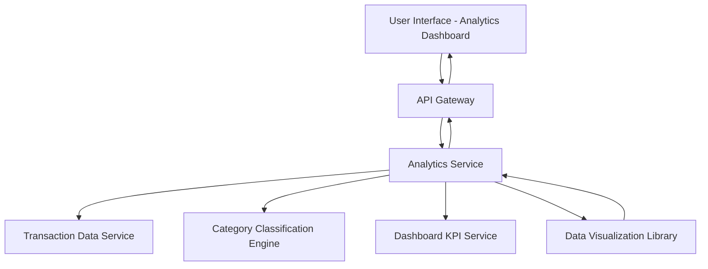

#### 1. High-Level Design

- **Summary:** This epic provides interactive visualizations and analytics to help users understand spending patterns through category-wise analysis and monthly trend tracking. It covers transaction tracking across 9 predefined categories (Food & Dining, Fuel, Shopping, Travel, Entertainment, Utilities, Healthcare, Education, Miscellaneous) with actionable insights.

- **Component Flow:**

- **Integration Points:**
  - **Upstream:** Transaction data service (for raw transaction records), Dashboard KPI service (for aggregated spend data), Category classification engine (for transaction categorization)
  - **Downstream:** Data visualization library (for rendering charts and graphs)

- **Key Assumptions:**
  - Transactions are pre-categorized or the category classification engine provides category assignments based on merchant/transaction metadata.
  - Historical transaction data is retained for trend analysis with sufficient granularity for monthly aggregation.

- **NFR Highlights:** Analytics visualizations must render within 3 seconds; support for at least 10,000 transactions per user; interactive and responsive charts across devices.

#### 2. Validation Report

- **Requirements Coverage:** The design comprehensively covers all scope elements including category-wise spending visualization, monthly trend analysis, transaction listing, interactive charts, spending pattern identification, and multi-category breakdown. The architecture addresses NFRs through dedicated analytics service with transaction data integration, category classification, and visualization library support, ensuring 3-second render time and handling 10,000+ transactions with responsive interactive charts.