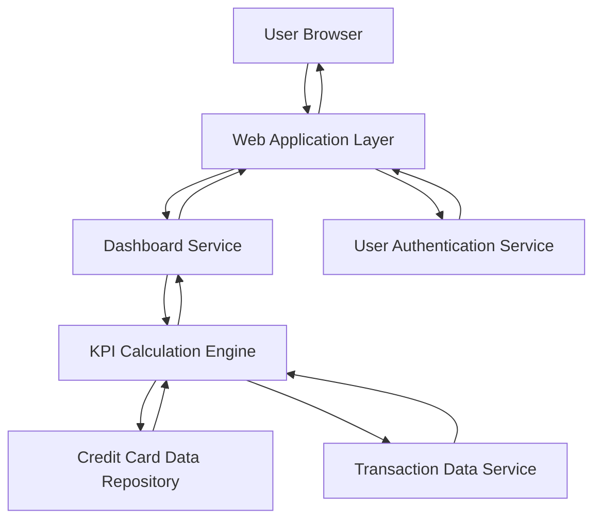

#### 1. High-Level Design

- **Summary:** This epic delivers a centralized dashboard displaying key financial KPIs (Monthly Spend, Total Credit Limit, Available Credit, Outstanding Amount) for credit card management. It serves as the primary landing page providing users with an at-a-glance consolidated view of their credit card financial health across all cards.

- **Component Flow:**

- **Integration Points:**
  - **Upstream:** User Authentication Service (for user-specific data access and session management)
  - **Downstream:** Credit Card Data Repository (for card details and credit limits), Transaction Data Service (for spend calculations and transaction history)

- **Key Assumptions:**
  - Transaction data is pre-aggregated on a daily basis for performance optimization.
  - Credit card data repository provides real-time or near-real-time data synchronization.

- **NFR Highlights:** Dashboard must load within 2 seconds; real-time KPI calculation; responsive design for desktop, tablet, and mobile; 100% data accuracy for financial calculations.

- **Data Flow:** User authenticates → Dashboard Service retrieves user context → KPI Calculation Engine fetches card details from Credit Card Data Repository and transaction data from Transaction Data Service → Engine computes Monthly Spend, Total Credit Limit, Available Credit, and Outstanding Amount → Aggregated KPIs are returned to Dashboard Service → Dashboard renders KPIs in responsive UI → User views consolidated financial health metrics.

#### 2. Validation Report

- **Requirements Coverage:** The design fully covers the epic's scope including all four KPI displays (Monthly Spend, Total Credit Limit, Available Credit, Outstanding Amount), consolidated view, and responsive layout. The architecture supports real-time calculation, sub-2-second load times through efficient data retrieval, and 100% financial accuracy through dedicated calculation engine. All stated NFRs (performance, responsiveness, accuracy) are addressed in the component design.