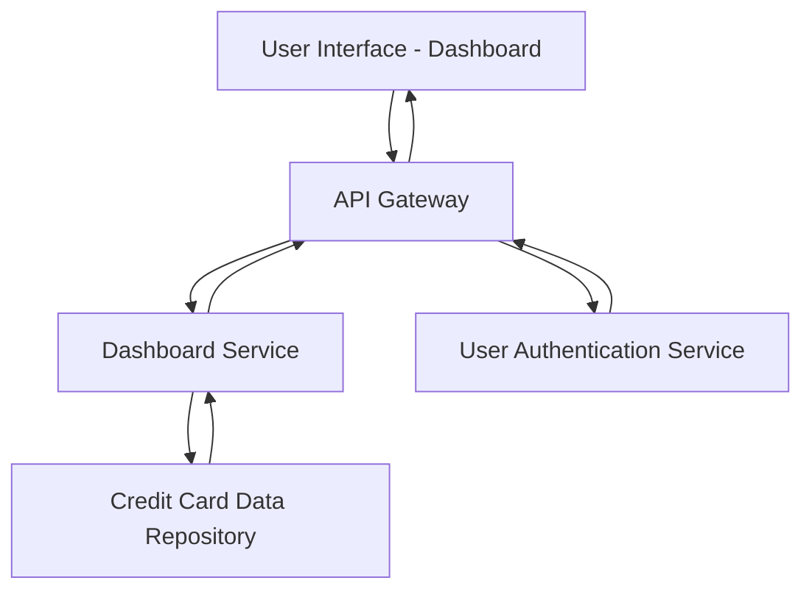

#### 1. High-Level Design

- **Summary:** This epic delivers a consolidated dashboard interface that aggregates and displays key performance indicators (KPIs) for all user credit cards, including monthly spend, total credit limit, available credit, and outstanding amounts. The solution provides real-time financial health monitoring with responsive design for cross-device access.

- **Component Flow:**

- **Integration Points:**
  - **Upstream:** User authentication service (for user identity verification)
  - **Downstream:** Credit card data source (for retrieving card details, balances, and transaction data)

- **Key Assumptions:** 
  - Credit card data is available in a structured format with real-time or near-real-time updates for accurate KPI calculation.
  - User authentication is handled externally and provides secure session tokens for API access.

- **NFR Highlights:** Dashboard must load within 2 seconds; support responsive design for mobile and desktop; accurate real-time credit metrics calculation.

#### 2. Validation Report

- **Requirements Coverage:** The design fully covers the epic's scope including dashboard interface, KPI calculations (monthly spend, credit limits, available credit, outstanding amounts), multi-card aggregation, and responsive layout. All stated NFRs (2-second load time, responsive design, real-time accuracy) are addressed through the component architecture with dedicated dashboard service and data repository integration.