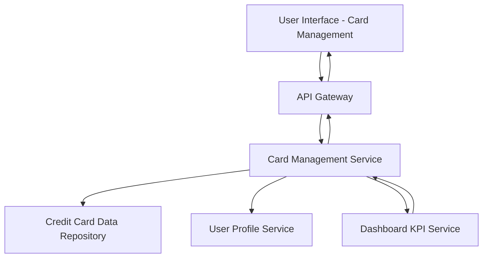

#### 1. High-Level Design

- **Summary:** This epic enables users to manage and track multiple credit cards within a unified platform. Users can view all registered cards, access detailed card-specific information, and perform card-wise spend analysis to monitor individual card performance and spending patterns.

- **Component Flow:**

- **Integration Points:**
  - **Upstream:** User profile service (for user identity and card associations), Dashboard KPI service (for card-specific metrics)
  - **Downstream:** Credit card data repository (for card details, balances, and transaction history)

- **Key Assumptions:**
  - Card data includes sufficient metadata for card-wise spend analysis and performance tracking.
  - User-card associations are maintained in the user profile service with secure access controls.

- **NFR Highlights:** System must support at least 20 credit cards per user; card data retrieval within 1 second; secure storage and display of card information.

#### 2. Validation Report

- **Requirements Coverage:** The design addresses all scope elements including multiple card display, card-wise spend analysis, individual card details, card listing interface, and card-specific metrics. The architecture supports the NFRs through dedicated card management service with integration to user profile and KPI services, ensuring 1-second retrieval and support for 20+ cards per user with secure data handling.