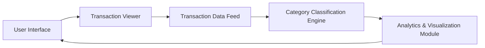

#### 1. High-Level Design

**Summary:**  
This epic provides comprehensive transaction visibility and interactive category-wise spending analytics across nine predefined categories (Food & Dining, Fuel, Shopping, Travel, Entertainment, Utilities, Healthcare, Education, Miscellaneous). Users can view transaction lists and analyze spending patterns through interactive visualizations to support data-driven financial decisions and budgeting.

**Component Flow:**

**Integration Points:**
- **Upstream:** Transaction data feed for transaction records
- **Upstream:** Category classification engine for categorizing transactions into predefined categories
- **Downstream:** None specified

**Key Assumptions:**
- Transaction data feed provides transaction details with merchant information for category classification
- Category classification uses rule-based or ML-based engine to auto-assign categories to transactions

**NFR Highlights:**  
Visualizations must render within 1 second; Support analysis of up to 10,000 transactions per user; Ensure accurate category classification

#### 2. Validation Report

**Requirements Coverage:**  
The design fully covers the epic scope: transaction listing, category-wise spending breakdown, interactive visualizations, nine predefined categories, and spending pattern analytics. The component architecture separates transaction viewing, category classification, and visualization rendering, ensuring the 1-second visualization rendering requirement through optimized data processing and client-side rendering techniques. The design supports up to 10,000 transactions per user through pagination, lazy loading, and efficient data structures. Category classification accuracy is ensured through dedicated classification engine with validation rules.