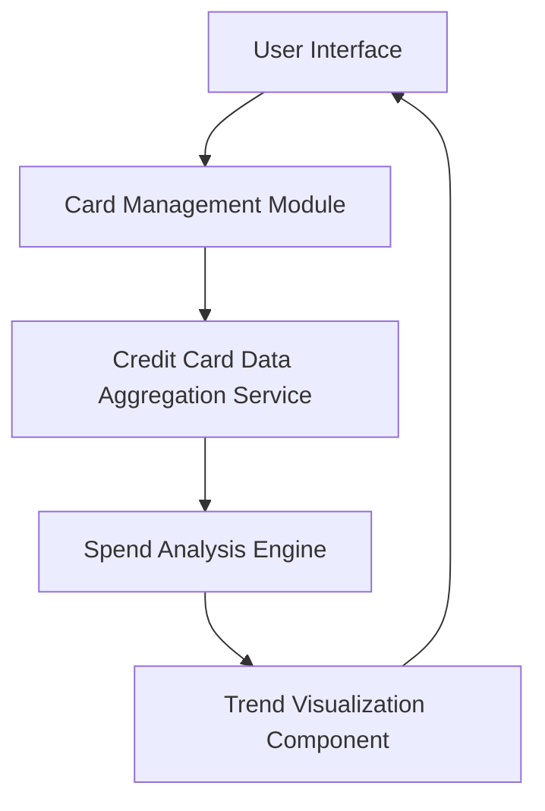

#### 1. High-Level Design

**Summary:**  
This epic enables users to manage multiple credit cards (up to 50 per user) within a unified interface, providing card-wise spend analysis, monthly spending trend visualization, and comparative analytics across the credit card portfolio. Users can identify usage patterns and optimize card utilization strategy through visual comparisons.

**Component Flow:**

**Integration Points:**
- **Upstream:** Credit card data aggregation service for multi-card information retrieval
- **Downstream:** None specified

**Key Assumptions:**
- Card data aggregation service returns card details and transaction history in a standardized format
- Monthly spend trends are calculated based on transaction timestamps aggregated by month

**NFR Highlights:**  
System must support management of up to 50 cards per user; Card data retrieval must complete within 500ms; Ensure data privacy and secure card information display

#### 2. Validation Report

**Requirements Coverage:**  
The design addresses all scope requirements: multiple credit card display, card viewing, monthly spend trend visualization, card-wise spend comparison, and spending pattern identification. The architecture separates card management, spend analysis, and visualization concerns, enabling the 500ms data retrieval requirement through optimized aggregation service calls. The design supports up to 50 cards per user through efficient data structures and caching strategies. Security and data privacy are addressed at the data aggregation service layer with secure transmission protocols.