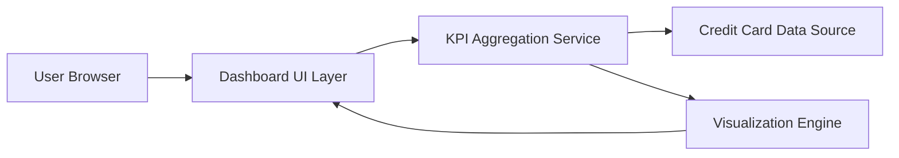

#### 1. High-Level Design

**Summary:**  
This epic delivers a responsive dashboard that provides users with consolidated visibility into key financial metrics including monthly spending, total credit limit across all cards, available credit, and outstanding amounts. The dashboard acts as the primary interface for credit card portfolio monitoring and credit utilization management.

**Component Flow:**

**Integration Points:**
- **Upstream:** Credit card data source for real-time balance, limit, and outstanding amount information
- **Downstream:** None specified

**Key Assumptions:**
- Credit card data source provides RESTful API with JSON format for balance and limit data
- KPI calculations (available credit, utilization percentage) are performed server-side before rendering

**NFR Highlights:**  
Dashboard must be responsive across all device sizes; Page load time must be under 2 seconds; Support concurrent viewing by multiple users

#### 2. Validation Report

**Requirements Coverage:**  
The design covers all stated scope elements: monthly spend display, total credit limit aggregation, available credit calculation, outstanding amount tracking, responsive layout, and KPI visualization. The component flow demonstrates clear separation between UI, aggregation logic, data source, and visualization rendering, ensuring the 2-second page load requirement can be met through efficient service design. The architecture supports concurrent users through stateless service design.