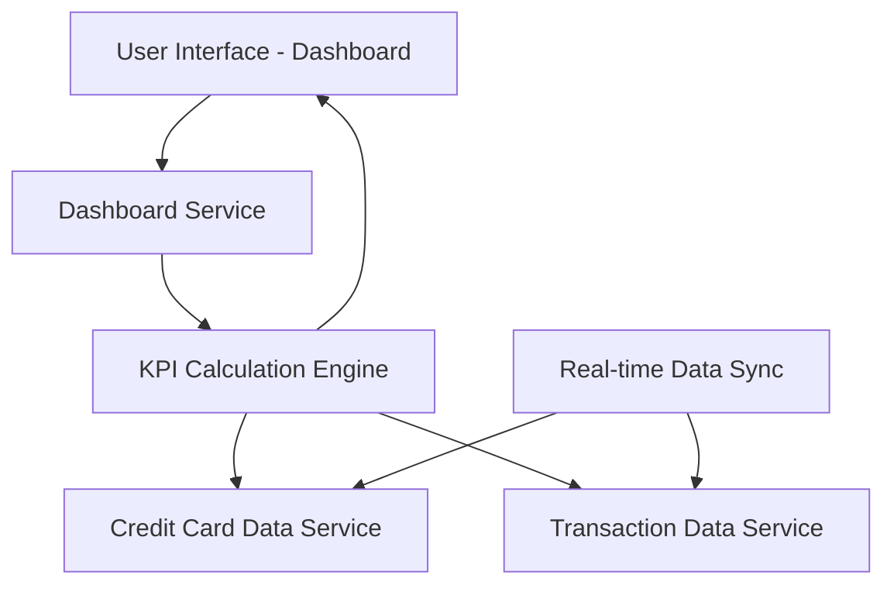

#### 1. High-Level Design

- **Summary**: This epic delivers a responsive, real-time financial dashboard that consolidates critical KPIs across all user credit cards into a single view. The dashboard displays four primary metrics: Monthly Spend (current month total), Total Credit Limit (sum across all cards), Available Credit (remaining credit capacity), and Outstanding Amount (total balance due). The solution provides instant visibility into overall credit health and utilization, enabling users to make informed spending and credit management decisions.

- **Component Flow**:

- **Integration Points**: 
  - **Upstream**: Credit Card data service for retrieving card details, credit limits, and current balances
  - **Upstream**: Transaction data service for calculating monthly spend from transaction records
  - **Internal**: Real-time Data Sync mechanism for near real-time updates of financial metrics
  - **Internal**: KPI Calculation Engine for aggregating data across multiple cards

- **Key Assumptions**: 
  - "Monthly Spend" is calculated as the sum of all transactions in the current calendar month; partial month or custom date range calculations are not required.
  - "Real-time or near real-time" updates imply data refresh intervals of 1-5 minutes; true sub-second real-time streaming is not required.

- **NFR Highlights**: Dashboard must be responsive across desktop, tablet, and mobile devices; KPI data must load within 2 seconds; system must support real-time or near real-time data updates for accurate financial metrics.

- **Data Flow**: User accesses dashboard → Dashboard Service initiates parallel requests to Credit Card Data Service and Transaction Data Service → Credit Card Data Service returns all user cards with limits and balances → Transaction Data Service returns current month transactions → KPI Calculation Engine aggregates data (sums credit limits, calculates available credit, totals outstanding amounts, computes monthly spend) → Calculated KPIs are rendered on responsive UI within 2 seconds → Real-time Data Sync periodically refreshes KPIs to maintain accuracy → User views consolidated financial health at a glance.

#### 2. Validation Report

- **Requirements Coverage**: The design fully addresses all scope requirements including Monthly Spend KPI display, Total Credit Limit calculation and display, Available Credit tracking, Outstanding Amount tracking, responsive dashboard layout, and consolidated view of all credit cards. The architecture supports all NFR requirements for responsive design across devices, 2-second load time, and real-time/near real-time data updates. All dependencies (Credit Card data service, Transaction data service) are properly integrated into the component flow. The design appropriately excludes out-of-scope items (real bank integration, payments, fund transfers, loans, payment gateway integration) as specified in the epic.