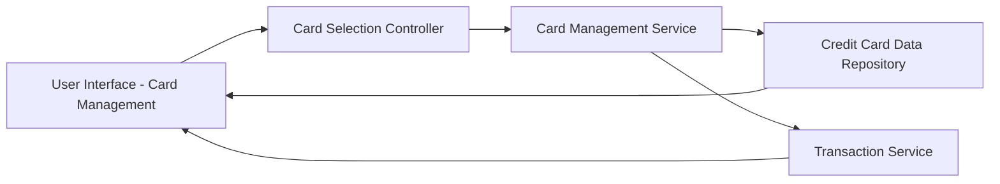

#### 1. High-Level Design

- **Summary**: This epic provides a unified interface for users to view, manage, and analyze multiple credit cards (up to 10 per user) from a single consolidated dashboard. Users can switch between cards, view individual card details (credit limit, outstanding balance, available credit), and access card-specific spending analysis. The solution eliminates the need for users to navigate multiple banking applications by providing a centralized credit card portfolio management experience.

- **Component Flow**:

- **Integration Points**: 
  - **Upstream**: Credit Card data repository for storing and retrieving card information (card details, limits, balances)
  - **Upstream**: Transaction service for calculating card-wise spending and transaction history
  - **Internal**: Card Selection Controller for managing card switching and active card state

- **Key Assumptions**: 
  - Credit card data (limits, balances) is maintained and updated by the Credit Card data repository; this epic does not handle adding new physical cards or real bank integration.
  - Card-wise spend analysis aggregates transactions by card identifier; transaction-to-card mapping is assumed to be already established in the transaction data.

- **NFR Highlights**: System must support at least 10 credit cards per user; card data retrieval must complete within 3 seconds; interface must maintain performance with multiple cards loaded simultaneously.

- **Data Flow**: User logs in and accesses card management interface → Card Management Service retrieves all user's credit cards from Credit Card Data Repository → UI displays card list with summary details (card name, last 4 digits, balance) → User selects a specific card via Card Selection Controller → Detailed card information is loaded (credit limit, outstanding balance, available credit) → Transaction Service provides card-specific spending analysis → User can switch between cards to view different card details and spending patterns.

#### 2. Validation Report

- **Requirements Coverage**: The design comprehensively addresses all scope items including display of multiple credit cards, card-wise spend analysis, individual card details view, card selection/switching functionality, and card-specific credit limit and balance displays. The architecture supports the NFR requirements for managing 10+ cards per user with 3-second data retrieval and maintained performance. All dependencies (Credit Card data repository, Transaction service) are properly integrated. The design respects the out-of-scope boundaries by excluding real bank integration, payments, fund transfers, and adding new physical cards as specified in the epic.