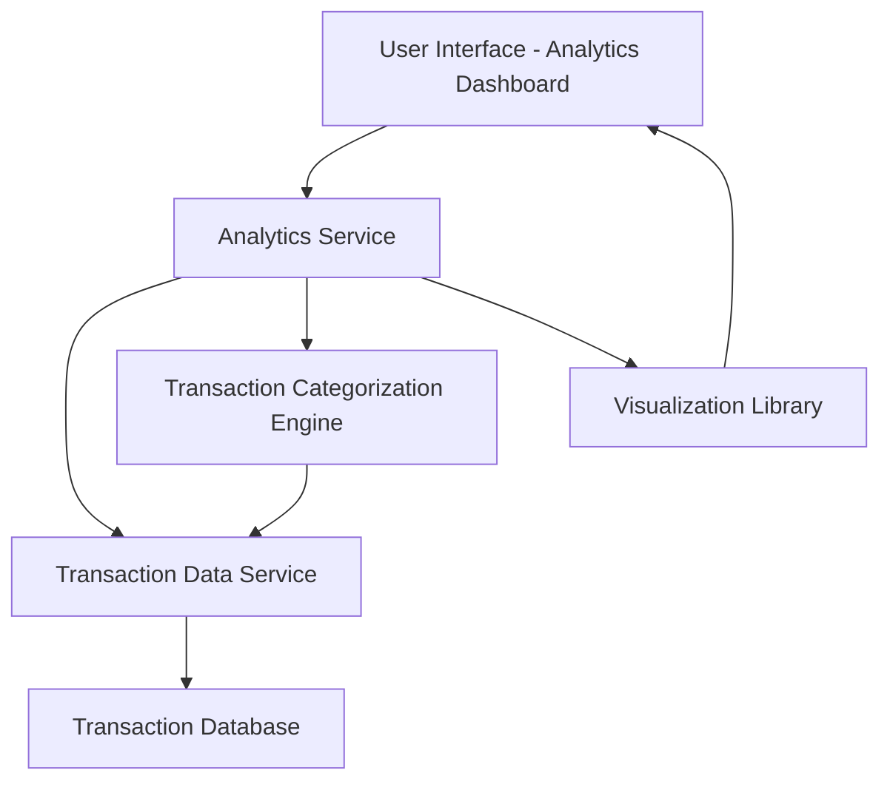

#### 1. High-Level Design

- **Summary**: This epic delivers a comprehensive spending analytics module that enables users to visualize and analyze their credit card spending patterns across nine predefined categories (Food & Dining, Fuel, Shopping, Travel, Entertainment, Utilities, Healthcare, Education, Miscellaneous). The solution provides interactive visualizations including monthly spend trends and category-wise breakdowns, processing up to 12 months of historical transaction data to help users make data-driven financial decisions.

- **Component Flow**:

- **Integration Points**: 
  - **Upstream**: Transaction data service for retrieving historical transaction records
  - **Upstream**: Transaction categorization service/logic for assigning expense categories to transactions
  - **External**: Visualization library (e.g., Chart.js, D3.js, or similar) for rendering interactive charts and graphs
  - **Data Source**: Transaction database containing at least 12 months of transaction history

- **Key Assumptions**: 
  - Transaction categorization is either pre-assigned by the transaction service or determined by rule-based logic (merchant codes, keywords); manual recategorization by users is out of scope.
  - Monthly spend trends will display data in calendar month format; fiscal year or custom date ranges are not required.

- **NFR Highlights**: Visualizations must render within 2 seconds; charts must be interactive and responsive across desktop, tablet, and mobile devices; system must handle 12+ months of transaction history; analytics engine must accurately categorize transactions.

- **Data Flow**: User accesses the analytics dashboard → Analytics Service requests transaction history from Transaction Data Service (12 months) → Transactions are processed through the Categorization Engine to assign/validate categories → Aggregated data (monthly totals, category breakdowns) is prepared → Visualization Library renders interactive charts (monthly trends, category pie/bar charts) → User interacts with visualizations to drill down into spending patterns and insights.

#### 2. Validation Report

- **Requirements Coverage**: The design fully covers the epic's stated scope including category-wise spending visualization across all nine categories, monthly spend trends analysis, and interactive chart rendering. The architecture supports the NFR requirements for 2-second render time, responsive design, and 12-month historical data processing. All identified dependencies (Transaction data service, categorization service, visualization library) are incorporated into the component flow. The design explicitly excludes out-of-scope items (predictive analytics, budget alerts, custom categories, report exports) as specified in the epic.