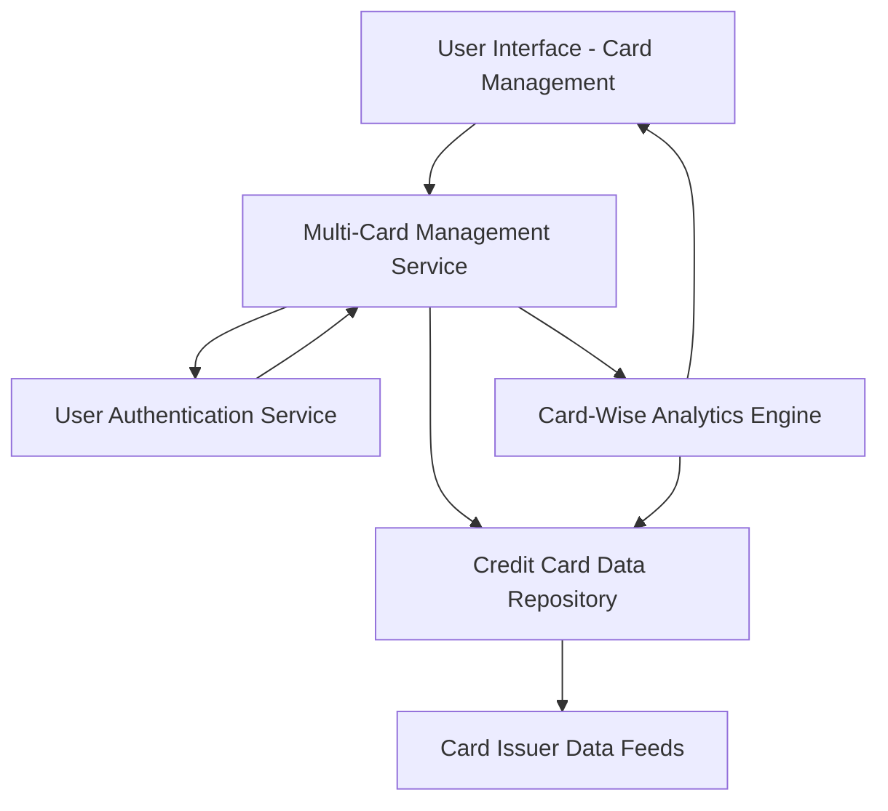

#### 1. High-Level Design

- **Summary:** This epic enables users to manage and monitor multiple credit cards (minimum 10 per user) through a unified interface. Users can view all cards in a consolidated list, access card-specific details (credit limits, balances, card information), perform card-wise spend analysis, and apply filtering/selection to focus on specific cards. The system ensures secure display of masked card information and maintains data isolation between user accounts.

- **Component Flow:**

- **Integration Points:**
  - **Upstream:** User authentication service (provides secure access and user identity verification)
  - **Upstream:** Credit card data repository (stores and retrieves card details, balances, limits)
  - **Upstream:** Card issuer data feeds (provides card information from issuing banks)
  - **Downstream:** Card Management UI for displaying card list, details, and spend analysis

- **Key Assumptions:**
  - Card information is synchronized periodically from card issuer data feeds; updates are not instantaneous.
  - Card masking follows PCI-DSS standards (e.g., displaying only last 4 digits).

- **NFR Highlights:** System must support minimum 10 credit cards per user; card data retrieval within 1 second; data isolation between user accounts; secure display of masked card information.

- **Data Flow:** User requests are authenticated via the User Authentication Service before accessing the Multi-Card Management Service. The service retrieves card information from the Credit Card Data Repository, which is populated by Card Issuer Data Feeds. For card-wise spend analysis, the Card-Wise Analytics Engine queries the repository for transaction data associated with specific cards, computes spending metrics per card, and returns results to the User Interface. The UI displays a consolidated card list with filtering/selection options, individual card details with masked information, and card-specific spend analysis visualizations.

#### 2. Validation Report

- **Requirements Coverage:** The design fully addresses the epic's scope including multiple credit card display, card-wise spend analysis, individual card details view, card selection and filtering, card-specific balance tracking, and per-card credit limit display. All NFRs are incorporated: support for 10+ cards per user, sub-1-second card data retrieval through optimized repository queries, data isolation enforced via user authentication service, and secure masked card display following PCI-DSS standards. Integration dependencies with user authentication service, credit card data repository, and card issuer data feeds are explicitly mapped in the component flow and align with the stated dependencies.