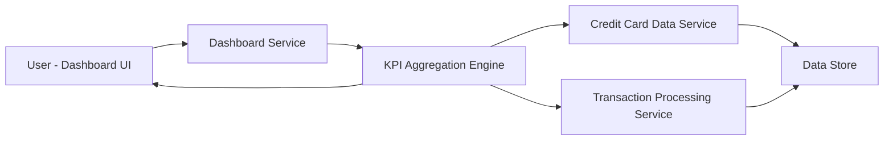

#### 1. High-Level Design

- **Summary:** This epic provides a consolidated dashboard interface that aggregates and displays critical financial KPIs across all user credit cards. The dashboard presents real-time metrics including monthly spending, total credit limit, available credit, and outstanding amounts in a single-pane view. It enables users to quickly assess their overall credit utilization and financial health without navigating multiple screens.

- **Component Flow:**

- **Integration Points:**
  - **Upstream:** Credit card data service (retrieves card balances, limits, and card details)
  - **Upstream:** Transaction processing service (calculates monthly spend and outstanding amounts)
  - **Downstream:** Dashboard UI components for KPI widgets and responsive layout rendering

- **Key Assumptions:**
  - Real-time data refresh occurs at defined intervals (e.g., every 5 minutes) rather than true real-time streaming.
  - Available credit is calculated as (Total Credit Limit - Outstanding Amount) across all cards.

- **NFR Highlights:** Dashboard must load within 2 seconds; real-time data refresh support; responsive design for desktop, tablet, and mobile viewports; concurrent user support.

- **Data Flow:** The Dashboard Service receives user requests and invokes the KPI Aggregation Engine. The engine retrieves card balance and limit data from the Credit Card Data Service and monthly spend/outstanding amount data from the Transaction Processing Service. Both services query the Data Store for persistent information. The KPI Aggregation Engine computes total credit limit, available credit, and aggregated spending metrics, then returns formatted KPI data to the Dashboard UI, which renders responsive widgets and cards displaying the financial metrics.

#### 2. Validation Report

- **Requirements Coverage:** The design comprehensively covers all scope elements: monthly spend display, total credit limit aggregation, available credit calculation, outstanding amount tracking, responsive dashboard layout, and KPI widgets. The architecture ensures 2-second load time through efficient KPI aggregation and caching strategies. Real-time data refresh is supported via the Dashboard Service polling mechanism. Responsive design requirements are addressed through the UI layer. Integration dependencies with credit card data service and transaction processing service are clearly defined and mapped in the component flow.