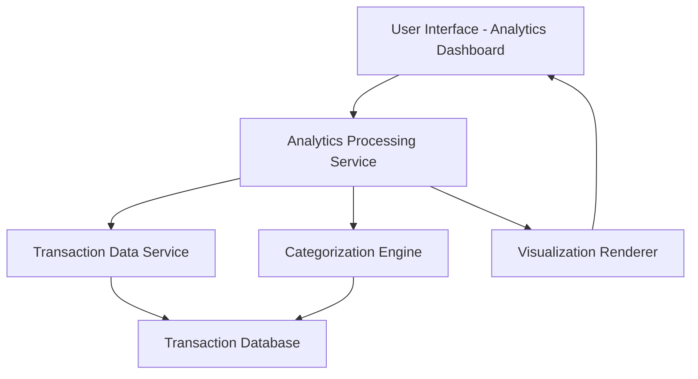

#### 1. High-Level Design

- **Summary:** This epic delivers a comprehensive spending analytics module that enables users to visualize and analyze their credit card expenses across 9 predefined categories (Food & Dining, Fuel, Shopping, Travel, Entertainment, Utilities, Healthcare, Education, Miscellaneous). The system automatically categorizes transactions, generates monthly spend trends, and presents interactive visualizations to help users understand spending behavior and identify optimization opportunities.

- **Component Flow:**

- **Integration Points:**
  - **Upstream:** Transaction data service (provides raw transaction details for analysis)
  - **Upstream:** Categorization engine (automatic transaction classification into 9 predefined categories)
  - **Upstream:** Analytics processing service (performs trend calculations and aggregations)
  - **Downstream:** User interface components for rendering charts and visualizations

- **Key Assumptions:**
  - Transactions are provided in a standardized format with merchant details sufficient for automatic categorization.
  - Monthly analysis window is based on calendar month; historical data is available for trend comparison.

- **NFR Highlights:** Analytics visualizations must render within 3 seconds; 95% categorization accuracy; interactive and responsive charts across all devices; support up to 1000 transactions per month per user.

- **Data Flow:** Raw transaction data flows from the Transaction Data Service to the Categorization Engine, which classifies each transaction into one of 9 predefined categories. The Analytics Processing Service aggregates categorized transactions to compute category-wise spending totals and monthly trends. Processed analytics data is sent to the Visualization Renderer, which generates interactive charts and graphs displayed on the User Interface Analytics Dashboard. Users interact with visualizations to drill down into specific categories or time periods.

#### 2. Validation Report

- **Requirements Coverage:** The design fully addresses the epic's stated scope including category-wise visualization, monthly trends, interactive charts, spending pattern analysis, transaction categorization across 9 categories, and trend comparison. All NFRs (3-second render time, 95% accuracy, responsive design, 1000 transactions/month capacity) are incorporated into the architecture through dedicated processing and rendering services. Integration dependencies with transaction data service, categorization engine, and analytics processing service are explicitly mapped in the component flow.