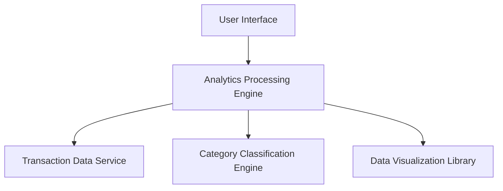

#### 1. High-Level Design

- **Summary:** This epic delivers comprehensive spending analytics with interactive visualizations and category-based analysis across 9 predefined categories (Food & Dining, Fuel, Shopping, Travel, Entertainment, Utilities, Healthcare, Education, Miscellaneous). The system processes transaction data, automatically categorizes expenses, and generates monthly spend trends through visual charts and graphs.

- **Component Flow:**

- **Integration Points:**
  - **Upstream:** Transaction Data Service (detailed transaction records)
  - **Downstream:** Category Classification Engine (automatic expense categorization), Data Visualization Library (chart/graph rendering), Analytics Processing Engine (trend calculation and pattern detection)

- **Key Assumptions:** 
  - Category classification uses a combination of merchant codes, transaction descriptions, and potentially machine learning models.
  - Monthly spend trends are calculated for configurable time periods (default assumed to be last 12 months).

- **NFR Highlights:** Analytics processing handles up to 10,000 transactions per user; visualization rendering completes within 3 seconds; high category classification accuracy; supports data aggregation for multiple time periods without performance impact.

- **Data Flow:** User requests spending analytics → Analytics Processing Engine retrieves transaction history from Transaction Data Service → Category Classification Engine maps each transaction to one of 9 predefined categories → Engine aggregates spending by category and time period, calculates monthly trends → Data Visualization Library generates interactive charts/graphs → UI displays category breakdowns, trend analysis, and spending patterns to user.

#### 2. Validation Report

- **Requirements Coverage:** The design comprehensively covers all epic requirements: category-wise visualization (9 categories), monthly spend trend analysis, interactive visualizations, transaction categorization and aggregation, spending pattern identification, historical comparison, and category breakdown reports. The architecture supports all stated NFRs (10,000 transactions, 3-second rendering, high classification accuracy, multi-period aggregation). The clear separation of analytics processing, classification, and visualization ensures maintainability and allows for future enhancements like predictive analytics.