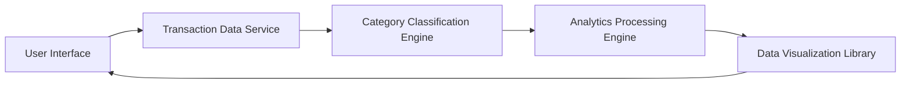

#### 1. High-Level Design

- **Summary:** This epic delivers comprehensive spending analytics with interactive visualizations and category-based analysis across 9 predefined categories (Food & Dining, Fuel, Shopping, Travel, Entertainment, Utilities, Healthcare, Education, Miscellaneous). The system presents monthly spend trends through visual charts, automatically categorizes expenses, and generates meaningful insights to help users understand spending patterns and optimize financial habits.

- **Component Flow:**

- **Integration Points:**
  - **Upstream:** Transaction Data Service (detailed transaction records)
  - **Internal:** Category Classification Engine (automatic expense categorization), Analytics Processing Engine (trend calculation and pattern detection), Data Visualization Library (chart/graph rendering)
  - **Downstream:** User Interface (interactive analytics presentation)

- **Key Assumptions:**
  - Category classification is performed automatically using rule-based or ML-based algorithms with periodic model updates to maintain accuracy.
  - Analytics processing supports multiple time periods (daily, weekly, monthly, yearly) with pre-aggregated data for common queries to meet 3-second response time.

- **NFR Highlights:** Analytics processing must handle up to 10,000 transactions per user; visualization rendering must complete within 3 seconds; category classification accuracy must be maintained at high levels; system must support data aggregation for multiple time periods without performance impact.

- **Data Flow:** User requests spending analytics → Transaction Data Service retrieves detailed transaction records → Category Classification Engine automatically categorizes each transaction into one of 9 predefined categories → Analytics Processing Engine aggregates spending by category and time period, calculates trends, and detects patterns → Data Visualization Library generates interactive charts and graphs → User Interface displays category breakdown reports, monthly spend trends, historical comparisons, and actionable insights with drill-down capabilities.

#### 2. Validation Report

- **Requirements Coverage:** The design comprehensively covers all stated requirements including category-wise spending visualization across 9 predefined categories, monthly spend trend analysis and charts, interactive data visualizations and graphs, transaction categorization and aggregation, spending pattern identification, historical spending comparison, and category breakdown reports. All NFRs (10,000 transactions per user, 3-second visualization rendering, high category classification accuracy, multi-period aggregation without performance impact) are addressed through appropriate architectural components. Dependencies on transaction data service, category classification engine, data visualization library, and analytics processing engine are clearly defined. Out-of-scope items (real bank integration, card payments, fund transfers, loans, payment gateway integration, predictive analytics, budget creation and alerts) are excluded as specified.