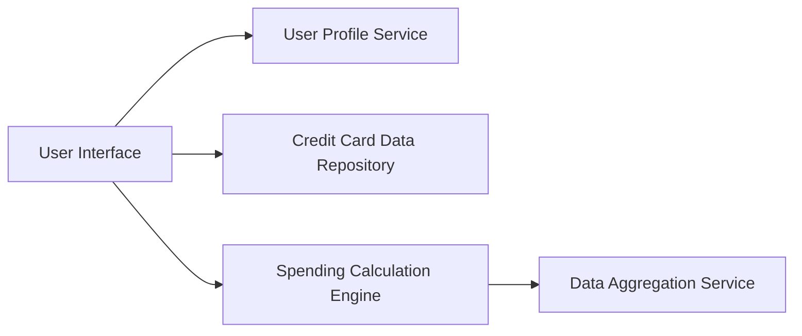

#### 1. High-Level Design

- **Summary:** This epic enables users to manage and monitor multiple credit cards in a unified interface, displaying card-specific information (type, credit limit, balance, utilization percentage) and providing card-wise spend analysis for comparison and optimization. The system supports adding, viewing, and organizing multiple cards.

- **Component Flow:**

- **Integration Points:**
  - **Upstream:** User Profile Service (card-user association)
  - **Downstream:** Credit Card Data Repository (card information storage), Spending Calculation Engine (card-wise analysis), Data Aggregation Service (multi-card views)

- **Key Assumptions:** 
  - Card utilization percentage is calculated as (current balance / credit limit) * 100.
  - Card organization features (categorization) allow user-defined grouping (e.g., personal vs. business cards).

- **NFR Highlights:** System must support minimum of 10 credit cards per user; card data retrieval and display within 1.5 seconds; data synchronization maintains consistency; secure storage with appropriate masking of sensitive information.

- **Data Flow:** User accesses multi-card view → User Profile Service identifies associated cards → Credit Card Data Repository retrieves card details (type, limit, balance) → Spending Calculation Engine computes card-wise spending and utilization percentage → Data Aggregation Service consolidates multi-card data → UI displays all cards with individual metrics and comparison views.

#### 2. Validation Report

- **Requirements Coverage:** The design fully addresses the epic's requirements: multiple card display, card-wise spend analysis, individual card detail views, card information management, credit utilization tracking per card, and card organization. The architecture supports all NFRs (10+ cards, 1.5-second retrieval, data consistency, secure storage with masking). The modular design facilitates extensibility for future card management features.