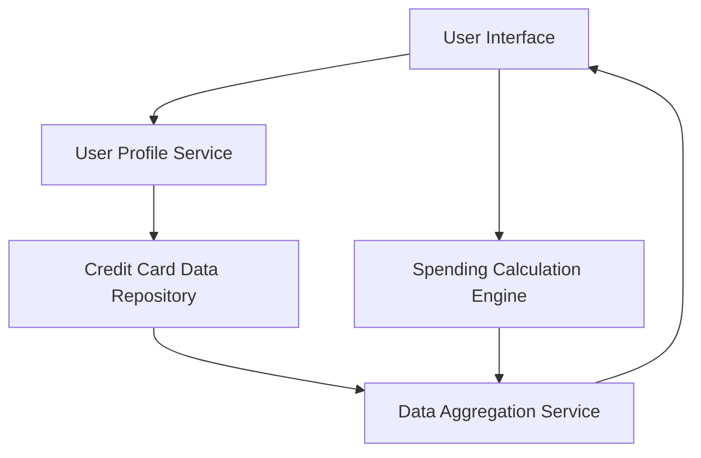

#### 1. High-Level Design

- **Summary:** This epic enables users to manage and monitor multiple credit cards within a single unified interface, displaying card type, credit limit, current balance, and utilization percentage for each card. The feature provides card-wise spend analysis for comparing spending patterns across different cards, supporting adding, viewing, and organizing multiple credit cards to optimize credit card usage strategy.

- **Component Flow:**

- **Integration Points:**
  - **Upstream:** User Profile Service (card-user account association)
  - **Internal:** Credit Card Data Repository (card information storage), Spending Calculation Engine (card-wise analysis), Data Aggregation Service (multi-card views)
  - **Downstream:** User Interface (card display and organization)

- **Key Assumptions:**
  - Card information is masked appropriately (e.g., showing only last 4 digits) for security; full card details are never transmitted to the client.
  - Data synchronization occurs periodically (e.g., every 5-10 minutes) to maintain consistency across cards while minimizing system load.

- **NFR Highlights:** System must support minimum of 10 credit cards per user account; card data retrieval and display must complete within 1.5 seconds; data synchronization across cards must maintain consistency; secure storage and display of sensitive card information with appropriate masking.

- **Data Flow:** User authenticates and accesses multi-card interface → User Profile Service retrieves associated card list → Credit Card Data Repository provides card details (type, limit, balance, utilization) → Spending Calculation Engine computes card-wise spend analysis → Data Aggregation Service consolidates multi-card view → User Interface displays all cards with relevant information, comparison metrics, and organization features → User can view, compare, and organize cards for optimized usage strategy.

#### 2. Validation Report

- **Requirements Coverage:** The design fully addresses the epic scope including multiple credit card display and listing, card-wise spend analysis and comparison, individual card detail views, card information management, credit utilization tracking per card, and card organization and categorization features. All NFRs (minimum 10 cards per user, 1.5-second retrieval and display, data synchronization consistency, secure storage with masking) are incorporated. Dependencies on credit card data repository, user profile service, spending calculation engine, and data aggregation service are explicitly mapped. Out-of-scope items (real bank integration, card payments, fund transfers, loans, payment gateway integration) are clearly excluded.