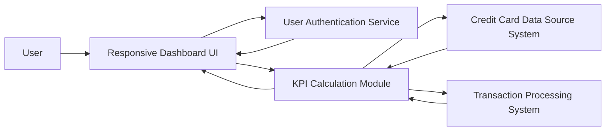

#### 1. High-Level Design

- **Summary:** This epic creates a centralized dashboard providing real-time visibility into credit card portfolio with critical financial metrics (monthly spend, total credit limit, available credit, outstanding amounts) aggregated across all credit cards. The modern, responsive interface ensures accessibility across devices for monitoring financial health anytime, anywhere.

- **Component Flow:**

- **Integration Points:**
  - **Upstream:** User Authentication Service (secure personal financial data access)
  - **Internal:** Credit Card Data Source System (card details and balances), Transaction Processing System (monthly spend and outstanding amounts calculation)
  - **Downstream:** Responsive Dashboard UI (cross-device presentation)

- **Key Assumptions:**
  - Real-time data refresh occurs at configurable intervals (e.g., every 30 seconds to 5 minutes) to balance freshness with system load.
  - Multiple credit card data is aggregated server-side before presentation to minimize client-side processing and ensure consistent performance.

- **NFR Highlights:** System must support responsive design across desktop, tablet, and mobile devices; dashboard load time must be under 2 seconds; real-time data refresh capability for KPI metrics; system must handle concurrent users viewing dashboard without performance degradation.

- **Data Flow:** User authenticates via User Authentication Service → Dashboard UI requests aggregated KPI data → KPI Calculation Module retrieves card details from Credit Card Data Source System and transaction data from Transaction Processing System → Module calculates and aggregates monthly spend, total credit limit, available credit, and outstanding amounts across all cards → Aggregated metrics are returned to Responsive Dashboard UI → User views consolidated real-time financial health metrics with device-optimized layout.

#### 2. Validation Report

- **Requirements Coverage:** The design comprehensively addresses all scope elements including dashboard KPI display for monthly spend, total credit limit, available credit, and outstanding amount, multiple credit card view integration, and responsive layout design for cross-device compatibility. All NFRs (responsive design across devices, under 2-second load time, real-time data refresh, concurrent user support) are incorporated into the architecture. Dependencies on credit card data source system, transaction processing system, and user authentication service are clearly defined. Out-of-scope items (real bank integration, card payments, fund transfers, loans, payment gateway integration) are excluded as specified.