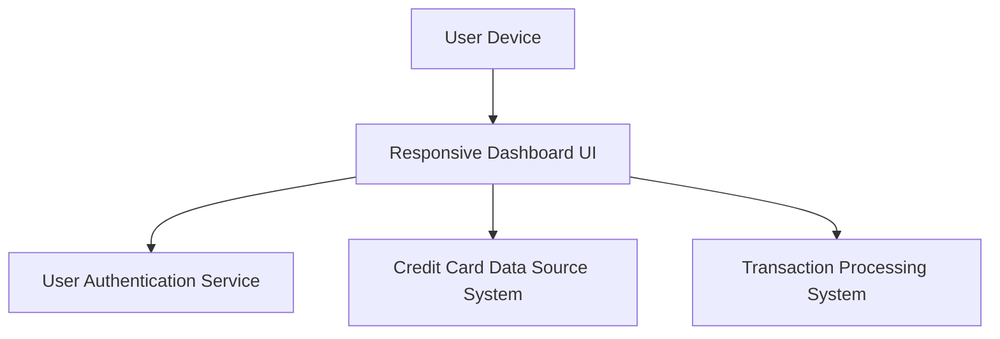

#### 1. High-Level Design

- **Summary:** This epic creates a centralized dashboard providing real-time visibility into credit card portfolios with KPIs for monthly spend, total credit limit, available credit, and outstanding amounts across all cards. The interface is responsive and accessible across devices, enabling users to monitor financial health and make informed decisions.

- **Component Flow:**

- **Integration Points:**
  - **Upstream:** User Authentication Service (secure personal data access)
  - **Downstream:** Credit Card Data Source System (card details and balances), Transaction Processing System (monthly spend and outstanding calculations)

- **Key Assumptions:** 
  - Multiple credit card aggregation logic resides in the dashboard backend or a dedicated aggregation service.
  - Real-time data refresh is achieved through periodic polling or event-driven updates (mechanism not specified).

- **NFR Highlights:** Responsive design across desktop, tablet, mobile; dashboard load time under 2 seconds; real-time data refresh for KPI metrics; handles concurrent users without performance degradation.

- **Data Flow:** User accesses dashboard from any device → User Authentication Service validates access → Dashboard UI requests data from Credit Card Data Source System (card details, limits, balances) and Transaction Processing System (monthly spend, outstanding amounts) → Backend aggregates data across all user's credit cards → Dashboard displays consolidated KPIs in responsive layout.

#### 2. Validation Report

- **Requirements Coverage:** The design comprehensively covers the epic's scope: KPI display for monthly spend, total credit limit, available credit, outstanding amount, multiple credit card integration, and responsive layout. The architecture supports all stated NFRs (responsive design, 2-second load time, real-time refresh, concurrent access). The clear separation between data sources and UI ensures flexibility and scalability.