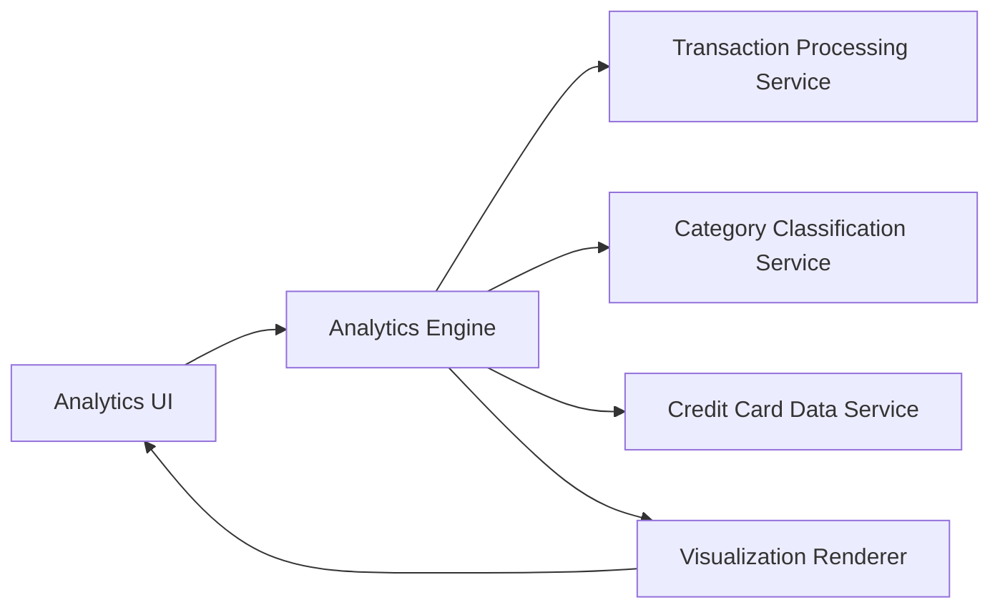

#### 1. High-Level Design

- **Summary:** This epic delivers an interactive analytics platform that visualizes spending patterns across nine predefined categories (Food & Dining, Fuel, Shopping, Travel, Entertainment, Utilities, Healthcare, Education, Miscellaneous). The system provides monthly trend analysis, card-wise spend comparison, and multi-dimensional breakdowns through responsive charts and graphs, enabling users to make data-driven financial decisions.

- **Component Flow:**

- **Integration Points:**
  - **Upstream:** Transaction Processing Service for raw transaction data
  - **Core Services:** Analytics Engine for data aggregation and computation, Category Classification Service for transaction categorization into 9 predefined categories
  - **Supporting:** Credit Card Data Service for card-wise analysis and metadata
  - **Presentation:** Visualization Renderer for generating interactive charts and graphs

- **Key Assumptions:**
  - Transactions are assumed to be auto-categorized by the Category Classification Service with at least 90% accuracy upon ingestion
  - Monthly trend analysis is assumed to cover the last 12 months of transaction history by default

- **NFR Highlights:** Analytics visualizations render within 2 seconds, interactive charts with smooth user interactions, data aggregation accurate to 2 decimal places, responsive and accessible charts across devices

- **Data Flow:** User accesses analytics dashboard → Analytics UI requests data from Analytics Engine → Engine retrieves raw transactions from Transaction Processing Service → Category Classification Service provides category mappings for transactions → Credit Card Data Service supplies card metadata for card-wise analysis → Engine aggregates data by category, month, and card with 2-decimal precision → Aggregated data is passed to Visualization Renderer → Interactive charts/graphs are generated and rendered in under 2 seconds → User interacts with visualizations to drill down into specific categories, time periods, or cards → UI updates dynamically with smooth transitions

#### 2. Validation Report

- **Requirements Coverage:** The design fully addresses the epic's scope including category-wise spending visualization, monthly spend trend analysis, card-wise spend analysis, interactive charts and graphs, spending pattern identification, and multi-dimensional breakdowns across 9 predefined categories. All NFRs are met through optimized rendering for 2-second visualization load times, interactive chart library supporting smooth interactions, precise aggregation algorithms ensuring 2-decimal accuracy, and responsive chart components for cross-device accessibility.