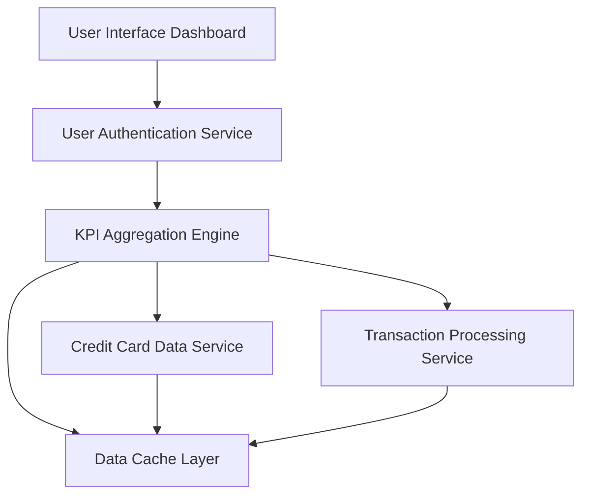

#### 1. High-Level Design

- **Summary:** This epic provides a consolidated dashboard that displays key performance indicators for the user's credit card portfolio, including monthly spend, total credit limit, available credit, and outstanding amounts. The dashboard aggregates data from multiple credit cards and presents real-time financial health metrics through a modern, responsive interface accessible across devices.

- **Component Flow:**

- **Integration Points:**
  - **Upstream:** User Authentication Service for secure access to user-specific card data
  - **Core Services:** Credit Card Data Service for card information and balances, Transaction Processing Service for monthly spend and outstanding amount calculations
  - **Performance:** Data Cache Layer for sub-2-second dashboard load times
  - **Presentation:** Responsive UI framework supporting mobile and desktop devices with WCAG 2.1 compliance

- **Key Assumptions:**
  - Credit card balance and limit data is assumed to be refreshed at least every 15 minutes from the Credit Card Data Service
  - Monthly spend calculations are assumed to be based on the current calendar month with daily aggregation

- **NFR Highlights:** Dashboard load time under 2 seconds, responsive design for mobile and desktop, real-time or near real-time data refresh, WCAG 2.1 accessibility compliance

- **Data Flow:** User logs in via Authentication Service → Dashboard UI requests KPI data from Aggregation Engine → Engine queries Credit Card Data Service for card limits, balances, and available credit → Engine queries Transaction Processing Service for monthly spend and outstanding amounts → Data is aggregated and cached → Cached results are returned to UI within 2 seconds → Dashboard displays KPIs with real-time updates → User can view individual card details or aggregated portfolio metrics

#### 2. Validation Report

- **Requirements Coverage:** The design comprehensively addresses all scope elements including dashboard KPIs display, monthly spend calculation, credit limit aggregation, available credit calculation, outstanding amount tracking, multiple credit card view, and responsive layout. All NFRs are satisfied through the caching layer for 2-second load times, responsive UI framework, near real-time data refresh mechanism, and WCAG 2.1 compliant interface components.