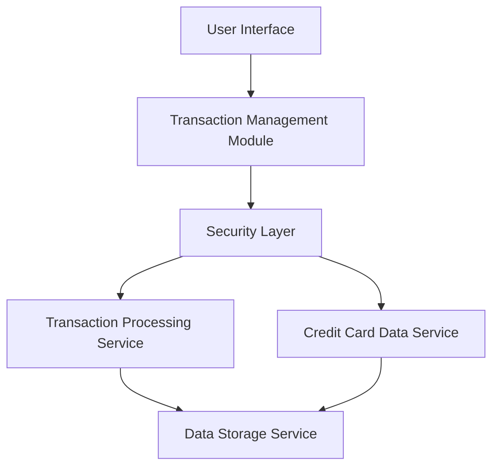

#### 1. High-Level Design

- **Summary:** This epic delivers a comprehensive transaction management interface that enables users to view, search, and filter credit card transactions across multiple cards. The system provides a unified transaction history view with detailed transaction information, supporting up to 10,000 transactions per user with efficient retrieval and display capabilities.

- **Component Flow:**

- **Integration Points:**
  - **Upstream:** User Authentication Service for secure user session management
  - **Core Services:** Transaction Processing Service for retrieving transaction data, Credit Card Data Service for card-specific filtering
  - **Downstream:** Data Storage Service for transaction history persistence and retrieval
  - **Security:** Encryption layer for data transmission and storage

- **Key Assumptions:**
  - Transaction data is assumed to be pre-categorized and stored in a standardized format (JSON/XML) by the Transaction Processing Service
  - Transaction updates are assumed to occur in near real-time with a maximum delay of 5 minutes from the source system

- **NFR Highlights:** System must handle up to 10,000 transactions per user, transaction list loading under 3 seconds, search/filter operations within 1 second, secure data transmission and storage with encryption

- **Data Flow:** User authenticates and accesses the transaction interface → UI sends request to Transaction Management Module → Security layer validates and forwards request to Transaction Processing Service → Service retrieves transaction data from Data Storage Service → Credit Card Data Service provides card metadata for filtering → Encrypted transaction data is returned to UI → User can apply filters/search which triggers optimized queries → Filtered results are displayed with pagination support

#### 2. Validation Report

- **Requirements Coverage:** The design fully covers the epic's stated scope including transaction listing, multi-card view, filtering, search capabilities, transaction details, card-wise filtering, and responsive interface. All NFRs are addressed through appropriate architectural components including performance optimization for 10,000 transactions, sub-3-second loading, sub-1-second search/filter, and encryption for security.