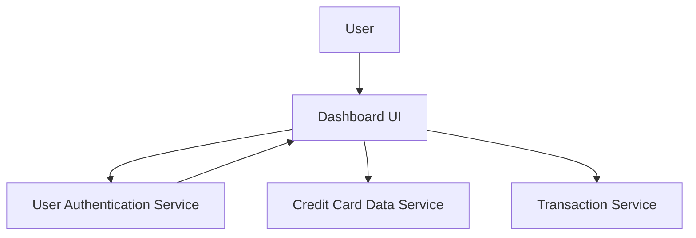

#### 1. High-Level Design

- **Summary:** This epic delivers a centralized, responsive dashboard displaying four critical KPIs: Monthly Spend, Total Credit Limit, Available Credit, and Outstanding Amount. The dashboard aggregates data from multiple credit cards and provides real-time updates, optimized for mobile, tablet, and desktop devices.

- **Component Flow:**

- **Integration Points:**
  - **Upstream:** User Authentication Service (secure access control)
  - **Downstream:** Credit Card Data Service (card details and limits), Transaction Service (monthly spend and outstanding amounts)

- **Key Assumptions:** 
  - KPI calculations are performed server-side with caching to meet the 2-second load time requirement.
  - Data refresh interval for real-time updates is configurable (assumed to be every few minutes or on-demand).

- **NFR Highlights:** Dashboard must load within 2 seconds; responsive design for mobile, tablet, desktop; real-time data refresh; supports concurrent users without performance degradation.

- **Data Flow:** User authenticates via User Authentication Service → Dashboard UI requests KPI data → Credit Card Data Service provides total credit limit and available credit → Transaction Service calculates monthly spend and outstanding amount → Dashboard aggregates and displays four KPIs (Monthly Spend, Total Credit Limit, Available Credit, Outstanding Amount) in responsive layout.

#### 2. Validation Report

- **Requirements Coverage:** The design addresses all stated requirements: display of four KPIs (Monthly Spend, Total Credit Limit, Available Credit, Outstanding Amount), responsive layout, consolidated view, and real-time updates. The architecture supports the NFRs (2-second load time, responsive design, concurrent access). The modular integration with separate services ensures scalability and maintainability.