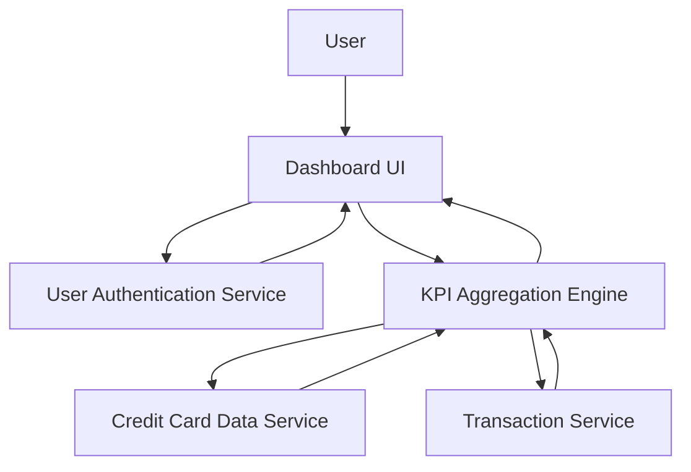

#### 1. High-Level Design

- **Summary:** This epic delivers a centralized dashboard displaying critical financial KPIs including Monthly Spend, Total Credit Limit, Available Credit, and Outstanding Amount. The dashboard provides an at-a-glance view of overall credit card financial health with a modern, responsive interface optimized for various devices (mobile, tablet, desktop).

- **Component Flow:**

- **Integration Points:**
  - **Upstream:** User Authentication Service (secure access control)
  - **Internal:** Credit Card Data Service (card details and limits), Transaction Service (monthly spend and outstanding amounts), KPI Aggregation Engine (metric calculation)
  - **Downstream:** Dashboard UI (responsive presentation layer)

- **Key Assumptions:**
  - KPI metrics are calculated in near-real-time with acceptable staleness of up to 5 minutes; data refresh occurs automatically without user intervention.
  - Monthly spend is calculated based on current billing cycle; outstanding amount includes all unpaid balances across all cards.

- **NFR Highlights:** Dashboard must load within 2 seconds; must support responsive design for mobile, tablet, and desktop viewports; system must handle real-time data refresh for KPI updates; must support concurrent access by multiple users without performance degradation.

- **Data Flow:** User authenticates via User Authentication Service → Dashboard UI requests KPI data → KPI Aggregation Engine retrieves card details from Credit Card Data Service and transaction data from Transaction Service → Engine calculates Monthly Spend, Total Credit Limit, Available Credit, and Outstanding Amount → Aggregated KPIs are returned to Dashboard UI → User views consolidated financial metrics with responsive layout across devices.

#### 2. Validation Report

- **Requirements Coverage:** The design fully addresses the epic scope including Monthly Spend KPI display, Total Credit Limit calculation and display, Available Credit computation and visualization, Outstanding Amount tracking, responsive dashboard layout, and consolidated view of financial metrics. All NFRs (2-second load time, responsive design for multiple viewports, real-time data refresh, concurrent user support) are incorporated. Dependencies on Credit Card Data Service, Transaction Service, and User Authentication Service are explicitly mapped. Out-of-scope items (real bank integration, payment processing, fund transfers, real-time bank synchronization) are clearly excluded.