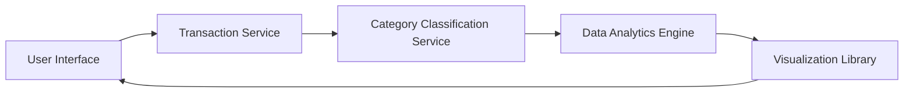

#### 1. High-Level Design

- **Summary:** This epic provides comprehensive analytics capabilities with interactive visualizations of spending patterns, including category-wise spending analysis across 9 predefined categories (Food & Dining, Fuel, Shopping, Travel, Entertainment, Utilities, Healthcare, Education, Miscellaneous) and monthly spend trend analysis. Users can explore spending behavior through intuitive charts and graphs to make informed financial decisions.

- **Component Flow:**

- **Integration Points:**
  - **Upstream:** Transaction Service (historical transaction data)
  - **Internal:** Category Classification Service (transaction-to-category mapping), Data Analytics Engine (aggregation and metric computation)
  - **Downstream:** Visualization Library (chart rendering)

- **Key Assumptions:**
  - Transactions are pre-classified into one of the 9 categories by the Category Classification Service with minimal latency; historical data is retained for at least 12 months.
  - Data Analytics Engine performs batch aggregation periodically (e.g., nightly) with on-demand recalculation for recent transactions to meet the 3-second query requirement.

- **NFR Highlights:** Analytics queries must return results within 3 seconds; visualizations must render smoothly with up to 12 months of transaction data; charts must be interactive and responsive; system must handle category classification for thousands of transactions efficiently.

- **Data Flow:** User requests spending analytics → Transaction Service retrieves historical transaction data → Category Classification Service maps transactions to 9 predefined categories → Data Analytics Engine aggregates spending by category and time period → Visualization Library generates interactive charts/graphs → UI displays category-wise spending breakdown and monthly trends with drill-down capabilities.

#### 2. Validation Report

- **Requirements Coverage:** The design comprehensively covers all stated requirements including category-wise spending visualization, monthly spend trend analysis, interactive charts and graphs, spending pattern identification across 9 categories, and historical spending comparison. All NFRs (3-second query response, smooth rendering with 12 months data, interactive/responsive charts, efficient classification) are addressed through appropriate architectural components. Dependencies on Transaction Service, Category Classification Service, and Data Analytics Engine are clearly defined. Out-of-scope items (predictive analytics, budget alerts, export, third-party integrations, tax reporting) are excluded as specified.