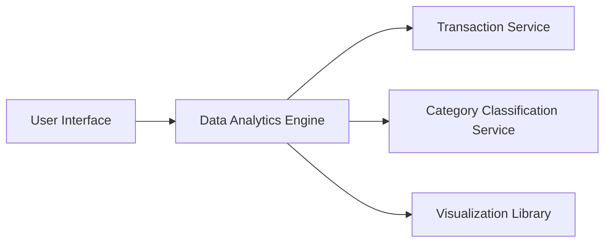

#### 1. High-Level Design

- **Summary:** This epic provides comprehensive spending analytics with category-wise visualization across 9 predefined categories (Food & Dining, Fuel, Shopping, Travel, Entertainment, Utilities, Healthcare, Education, Miscellaneous) and monthly trend analysis. The system processes historical transaction data, applies automatic categorization, and renders interactive charts for user insights.

- **Component Flow:**

- **Integration Points:**
  - **Upstream:** Transaction Service (historical transaction data), Category Classification Service (transaction-to-category mapping)
  - **Downstream:** Data Analytics Engine (aggregation and computation), Visualization Library (chart rendering)

- **Key Assumptions:** 
  - Transactions are pre-classified or classified in near-real-time by the Category Classification Service using rule-based or ML models.
  - Historical data is retained for at least 12 months to support trend analysis.

- **NFR Highlights:** Analytics queries return results within 3 seconds; visualizations render smoothly with up to 12 months of data; efficient category classification for thousands of transactions.

- **Data Flow:** User requests analytics view → Data Analytics Engine queries Transaction Service for historical transactions → Category Classification Service maps transactions to 9 predefined categories → Engine aggregates spending by category and time period → Visualization Library renders interactive charts/graphs → UI displays category breakdowns and monthly trends to user.

#### 2. Validation Report

- **Requirements Coverage:** The design fully covers the epic's scope: category-wise visualization (9 categories), monthly trend analysis, interactive charts, spending pattern identification, and historical comparison. The architecture supports the NFRs (3-second query response, 12-month data handling, efficient categorization). The separation of concerns (analytics, classification, visualization) ensures maintainability and extensibility.